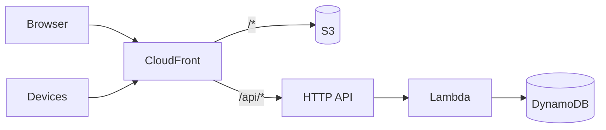

# AWS Architecture by Example

A six-chapter course for developers who know one or two AWS services and want to design whole systems. Every chapter starts from a brief that could have come from a client, draws a reference architecture in Mermaid, explains each service choice against its alternatives, prices it from the AWS Price List, lists how it fails, and gives an AWS CDK (Python) skeleton that synthesises in `make check`. Nothing in this repo deploys itself; the deploy commands are in each example's README for you to run from your own account.



*The chapter 1 shape. Later chapters replace or extend one part of it at a time.*

## Chapters

| # | Chapter | One line |
|---|---|---|
| 1 | [Static site + API + DB](ch01-static-site-api-db.md) | The "hello world" of architectures: one CloudFront hostname, S3 + HTTP API + Lambda + DynamoDB, priced at $8 and $739 a month, with the failure table and a 26-resource CDK stack. |
| 2 | IoT telemetry at scale | *(not yet written)* AWS IoT Core → rules → hot and cold storage; what changes between 20 and 100 000 devices. |
| 3 | Batch ML training and inference on a schedule | *(not yet written)* S3, Step Functions, SageMaker or ECS. |
| 4 | Event-driven order processing | *(not yet written)* SQS, SNS, EventBridge; idempotency and dead-letter queues. |
| 5 | Multi-region, backups, RPO and RTO | *(not yet written)* |
| 6 | Cost and security review checklist | *(not yet written)* Well-Architected mapped to the five designs. |

## Running the examples

```bash
pip install -r requirements.txt   # aws-cdk-lib, constructs, boto3, pytest, ruff
make check                         # lint, tests, synthesise every stack, print the cost tables
```

Each `examples/chNN/` folder has a README with that chapter's file map and the deploy commands.

## What the examples are and are not

- Every stack synthesises to CloudFormation in-process (`python app.py`), so `make check` needs no CDK CLI, no Node.js beyond what `aws-cdk-lib` itself uses, and no AWS credentials.
- Template properties the chapters rely on are asserted by tests, so a chapter's claims about its stack are checked, not just stated.
- Costs are computed by a script from a `prices.json` that records where and when each price was copied. They are list prices, first tier, no free tier.
- Nothing has been deployed from this repo. Deploying is the reader's step, and each example README says what to expect.

## Licence

MIT, see [LICENSE](LICENSE).
