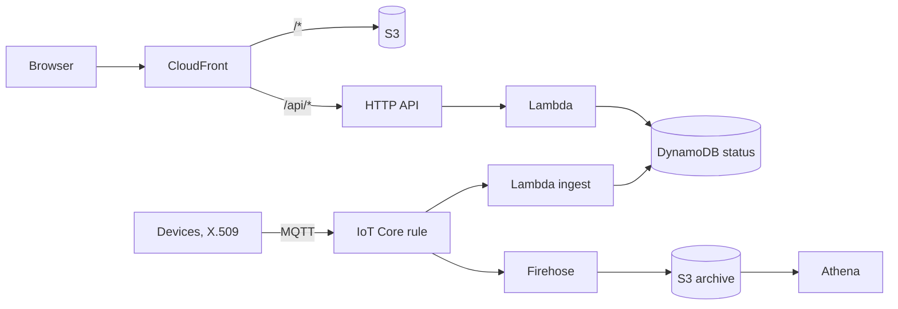

# AWS Architecture by Example

A six-chapter course for developers who know one or two AWS services and want to design whole systems. Every chapter starts from a brief that could have come from a client, draws a reference architecture in Mermaid, explains each service choice against its alternatives, prices it from the AWS Price List, lists how it fails, and gives an AWS CDK (Python) skeleton that synthesises in `make check`. Nothing in this repo deploys itself; the deploy commands are in each example's README for you to run from your own account.



*Chapters 1 and 2 together: the page and API from chapter 1 read the status table that chapter 2's device path writes. Later chapters replace or extend one part at a time.*

## Chapters

| # | Chapter | One line |
|---|---|---|
| 1 | [Static site + API + DB](ch01-static-site-api-db.md) | The "hello world" of architectures: one CloudFront hostname, S3 + HTTP API + Lambda + DynamoDB, priced at $8 and $739 a month, with the failure table and a 26-resource CDK stack. |
| 2 | [IoT telemetry at scale](ch02-iot-telemetry-at-scale.md) | One certificate per device, one IoT Core rule fanning out to DynamoDB (status + 30-day history) and Firehose → S3 → Athena, a fleet watchdog instead of per-device alarms; priced at $3, $110 and $10 898 a month for 20, 1 000 and 100 000 devices, and $2 665 after batching and provisioned capacity. |
| 3 | Batch ML training and inference on a schedule | *(not yet written)* S3, Step Functions, SageMaker or ECS. |
| 4 | Event-driven order processing | *(not yet written)* SQS, SNS, EventBridge; idempotency and dead-letter queues. |
| 5 | Multi-region, backups, RPO and RTO | *(not yet written)* |
| 6 | Cost and security review checklist | *(not yet written)* Well-Architected mapped to the five designs. |

## Running the examples

```bash
pip install -r requirements.txt   # aws-cdk-lib, constructs, boto3, pytest, ruff
make check                         # lint, tests, synthesise every stack, print the cost tables
```

Each `examples/chNN/` folder has a README with that chapter's file map and the deploy commands.

## What the outputs look like

`make check` ends with the cost tables each chapter's `cost.py` prints; the chapters quote them verbatim. The tail of a green run:

```
python3 -m pytest -q
.................................................                        [100%]
49 passed in 3.87s
cd examples/ch01 && python3 app.py && test -f cdk.out/Ch01HelloStack.template.json
cd examples/ch02 && python3 app.py && test -f cdk.out/Ch02TelemetryStack.template.json
cd examples/ch01 && python3 cost.py
| Line item | small (2,000/day) | busy (200,000/day) |
| **Total / month** | **$8.47** | **$739.13** |
cd examples/ch02 && python3 cost.py
| Line item | 20 devices | 1 000 devices | 100 000 devices |
| **Total / month** | **$2.85** | **$109.65** | **$10,898.12** |
| per device / month | $0.1427 | $0.1096 | $0.1090 |
```

`cdk.out/<Stack>.template.json` is the CloudFormation each chapter would deploy: 26 resources for chapter 1, 41 for chapter 2. Each `examples/chNN/README.md` lists the deploy commands and what to expect after them.

## Layout

```
chNN-<slug>.md          one chapter: brief, architecture, choices, worked example, cost, failures, exercises
examples/chNN/          its CDK app (app.py, stack.py), Lambda code, cost.py + prices.json, tests/, README.md
Makefile                check = lint + test + synth + cost, over every chapter
WALKTHROUGH.md          notes for the author: design rationale and likely questions, per chapter
TODO.md                 open items, with what each needs
```

## What the examples are and are not

- Every stack synthesises to CloudFormation in-process (`python app.py`), so `make check` needs no CDK CLI, no Node.js beyond what `aws-cdk-lib` itself uses, and no AWS credentials.
- Template properties the chapters rely on are asserted by tests, so a chapter's claims about its stack are checked, not just stated.
- Costs are computed by a script from a `prices.json` that records where and when each price was copied. They are list prices, first tier, no free tier.
- Nothing has been deployed from this repo. Deploying is the reader's step, and each example README says what to expect.

## Limitations

- Nothing here has been deployed; IAM, network and delivery behaviour are asserted from templates and from handlers run against fakes. Each example README says what a first deploy should show.
- Prices are list prices for US East (N. Virginia) on the dates recorded in each `prices.json`; mostly first tier, no free tier. They are inputs to a model, not a quote.
- The two real repos the chapters refer to ([queen-bee-incubator](https://github.com/Mariam-zeqred/queen-bee-incubator), [smart-poultry-farm](https://github.com/Mariam-zeqred/smart-poultry-farm)) are described from their READMEs only.

## Next steps

- Chapter 3: batch ML training and inference on a schedule, reading the archive chapter 2 writes.
- Deploy chapters 1 and 2 once from a personal account, record what the templates could not prove (bucket policy, Basic Ingest, Firehose delivery), then `cdk destroy`.
- Open items per chapter are in [TODO.md](TODO.md).

## Licence

MIT, see [LICENSE](LICENSE).
