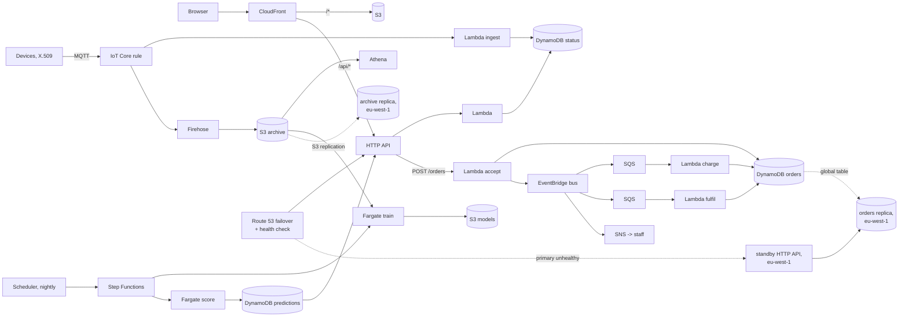

# AWS Architecture by Example

A six-chapter course for developers who know one or two AWS services and want to design whole systems; five chapters are written so far. Every chapter starts from a brief that could have come from a client, draws a reference architecture in Mermaid, explains each service choice against its alternatives, prices it from the AWS Price List, lists how it fails, and gives an AWS CDK (Python) skeleton that synthesises in `make check`. Nothing in this repo deploys itself; the deploy commands are in each example's README for you to run from your own account.



*Chapters 1 to 5 together: the page and API from chapter 1 read the status table that chapter 2's device path writes, chapter 3's nightly job reads chapter 2's archive and writes a forecast per device for the same page, chapter 4 takes the cooperative's orders from the same API through a bus and two queues, and chapter 5 copies the orders and the archive to a second region with a standby API that DNS switches to when the first stops answering. Chapter 6 reviews all five.*

## Chapters

Chapters 1 to 5 are written and runnable; chapter 6 is still to come in the next build session, and its row below says so until it lands.

| # | Chapter | One line |
|---|---|---|
| 1 | [Static site + API + DB](ch01-static-site-api-db.md) | The "hello world" of architectures: one CloudFront hostname, S3 + HTTP API + Lambda + DynamoDB, priced at $8 and $739 a month, with the failure table and a 26-resource CDK stack. |
| 2 | [IoT telemetry at scale](ch02-iot-telemetry-at-scale.md) | One certificate per device, one IoT Core rule fanning out to DynamoDB (status + 30-day history) and Firehose → S3 → Athena, a fleet watchdog instead of per-device alarms; priced at $3, $110 and $10 898 a month for 20, 1 000 and 100 000 devices, and $2 665 after batching and provisioned capacity. |
| 3 | [Batch ML on a schedule](ch03-batch-ml-on-a-schedule.md) | EventBridge Scheduler → Step Functions → a Fargate container that trains on chapter 2's archive, a gate Lambda that promotes a candidate only if it beats "same as yesterday" and the current model on the same hold-out week, the same container scoring every device; priced at $0.63, $0.87 and $24.88 a month for 20, 1 000 and 100 000 devices, where the problem is a 15-hour task rather than the bill, and $3.94 with Athena building the features. |
| 4 | [Event-driven order processing](ch04-event-driven-order-processing.md) | A client-made order id and a conditional put, a forward-only status moved by conditional updates, the provider's idempotency key and one DynamoDB transaction for the stock: three guards that make every at-least-once delivery safe to repeat; EventBridge rules into one SQS queue per consumer, partial batch responses, a dead-letter queue and alarm per queue, an archive to replay from; a simulated month of bad luck charges 500 orders exactly once with the guards and 128 of them twice without; priced at $0.65, $2.36 and $171.72 a month for 2 000, 100 000 and 10 000 000 orders, against $2 000 for the messaging alone as Standard workflows. |
| 5 | [Multi-region, backups, RPO and RTO](ch05-multi-region-backups-rpo-rto.md) | One RPO and one RTO per data set before any copy is chosen; a DynamoDB global table replica, replicated buckets and a daily backup copied to a second region, one stack class deployed twice, a Route 53 failover record on a health check that reads the table, CloudFront falling back to the replica bucket; a drill of four disasters against four strategies shows replication is for the region and backups are for you, and a second drill shows a stock counter losing six reservations when two regions write it; priced at $3.91 and $42.21 a month added, against $1.00 and $38.51 for backup and restore. |
| 6 | Cost and security review checklist | *(not yet written)* Well-Architected mapped to the five designs. |

## Running the examples

```bash
pip install -r requirements.txt   # aws-cdk-lib, constructs, boto3, pytest, ruff
make check                         # lint, tests, synthesise every stack, print the cost tables
```

Each `examples/chNN/` folder has a README with that chapter's file map and the deploy commands.

## What the outputs look like

`make check` ends with the cost tables each chapter's `cost.py` prints; the chapters quote them verbatim. The tail of a green run:

```
python3 -m pytest -q
..........................................................................................................  [100%]
144 passed in 15.94s
cd examples/ch01 && python3 app.py && test -f cdk.out/Ch01HelloStack.template.json
cd examples/ch02 && python3 app.py && test -f cdk.out/Ch02TelemetryStack.template.json
cd examples/ch03 && python3 app.py && test -f cdk.out/Ch03BatchMlStack.template.json
cd examples/ch04 && python3 app.py && test -f cdk.out/Ch04OrdersStack.template.json
cd examples/ch05 && python3 app.py && test -f cdk.out/Ch05PrimaryStack.template.json && test -f cdk.out/Ch05StandbyStack.template.json
cd examples/ch01 && python3 cost.py
| **Total / month** | **$8.47** | **$739.13** |
cd examples/ch02 && python3 cost.py
| **Total / month** | **$2.85** | **$109.65** | **$10,898.12** |
cd examples/ch03 && python3 cost.py
| **Total / month** | **$0.63** | **$0.87** | **$24.88** |
| training task wall time / night | 1 min 11 s | 10 min 21 s | 15 h 37 min |
cd examples/ch04 && python3 cost.py
| **Total / month** | **$0.65** | **$2.36** | **$171.72** |
cd examples/ch05 && python3 cost.py
| **Added / month** | **$3.91** | **$42.21** |
| backup & restore (daily copies + replicated archive + a zone) | $1.00 | $38.51 |
cd examples/ch03/pipeline && python3 -m cli train --archive ../local/archive ...
  "mae": 2.0079924097774433, "baseline_mae": 2.6729114055633545, "champion_mae": null
cd examples/ch03 && python3 lambda/gate.py --artifacts local/artifacts --run-id 2026-10-19
  "promoted": true, "reason": "no current model; candidate MAE 2.008"
cd examples/ch03/pipeline && python3 -m cli score ...
  "devices_scored": 10, "devices_over_threshold": 5
cd examples/ch04 && python3 sim.py --orders 500 --seed 1
| orders charged twice or more | 0 | 128 |
| oversold SKUs | [] | ['SHT31-NODE'] |
| payment DLQ | 3 | 4 |
cd examples/ch05 && python3 drill.py && python3 drill.py conflict
| region unavailable (6 h) | lost: none, if the region comes back; down: 6 h | lost: up to 24 h (the last copy); down: 70 min | lost: ~1 s of replication lag; down: 2.5 min to read and accept; 30 min until charged | ...
| script deletes every order | lost: none (PITR); down: 50 min | lost: none (PITR); down: 50 min | lost: none (PITR); down: 50 min | ...
| units reserved | 12 | 6 |
| reservations the counter lost | 6 | 0 |
```

`cdk.out/<Stack>.template.json` is the CloudFormation each chapter would deploy: 26 resources for chapter 1, 41 for chapter 2, 45 for chapter 3, 43 for chapter 4, 42 + 23 for chapter 5's two regions. Chapter 3's part of `make check` runs its pipeline on a synthetic archive (`examples/ch03/local/`, git-ignored); chapter 4's runs its three functions through fake at-least-once queues with and without their guards; chapter 5's prints a disasters-by-strategies table from named parameters and then decrements one stock counter from two regions of a fake global table. The numbers they print describe their generators and parameters, not a field, a shop or an outage. Each `examples/chNN/README.md` lists the deploy commands and what to expect after them.

## Layout

```
chNN-<slug>.md          one chapter: brief, architecture, choices, worked example, cost, failures, exercises
examples/chNN/          its CDK app (app.py, stack.py), Lambda code, cost.py + prices.json, tests/, README.md
examples/ch03/pipeline/ the container chapter 3 runs on Fargate; the same code runs locally (make ch03-run)
examples/ch04/sim.py    chapter 4's functions against fake queues, provider and crashes (make ch04-sim)
examples/ch05/drill.py  chapter 5's disasters x strategies table and the two-region counter (make ch05-drill)
Makefile                check = lint + test + synth + cost + ch03-run + ch04-sim + ch05-drill, over every chapter
WALKTHROUGH.md          notes for the author: design rationale and likely questions, per chapter
TODO.md                 open items, with what each needs
```

## What the examples are and are not

- Every stack synthesises to CloudFormation in-process (`python app.py`), so `make check` needs no CDK CLI, no Node.js beyond what `aws-cdk-lib` itself uses, and no AWS credentials.
- Template properties the chapters rely on are asserted by tests, so a chapter's claims about its stack are checked, not just stated.
- Costs are computed by a script from a `prices.json` that records where and when each price was copied. They are list prices, first tier, no free tier.
- Nothing has been deployed from this repo. Deploying is the reader's step, and each example README says what to expect.

## Limitations

- Nothing here has been deployed; IAM, network and delivery behaviour are asserted from templates and from handlers run against fakes. Each example README says what a first deploy should show. Chapter 3's container image is not built here (no Docker daemon in the sandbox); `cdk deploy` builds it.
- Chapter 3's data is synthetic: `examples/ch03/pipeline/synth_archive.py` writes it, and every number from the local run (MAE 2.01 °C against a 2.67 °C baseline, 5 of 10 fields over 30 °C) describes that generator. The throughput constants in its cost model were measured on the sandbox's CPU, not on Fargate.
- Chapter 4's failure rates (lost replies, duplicate deliveries, lost provider responses, crashes) are parameters of `examples/ch04/sim.py`, not measurements; its functions are tested against in-memory fakes of DynamoDB, SQS and EventBridge, and its payment provider is a stub. The idle-polling line of its cost model is a documented minimum, assumed rather than measured.
- Chapter 5's two stacks have never been deployed either, and this one has the most that only a deploy can show: the replication role on two buckets, the backup copy into another region's vault, the certificate validation in a real zone, a health check reaching the API, CloudFront reading the standby bucket. Its drill table is arithmetic over parameters (outage length, how long a person and a restore take), labelled as such; its conflict drill is a real simulation of last-writer-wins, in memory. Two prices in its `prices.json` are from documentation the sandbox could not reach and are named there.
- Prices are list prices for US East (N. Virginia), and for chapter 5 also EU (Ireland), on the dates recorded in each `prices.json`; mostly first tier, no free tier. They are inputs to a model, not a quote.
- The two real repos the chapters refer to ([queen-bee-incubator](https://github.com/Mariam-zeqred/queen-bee-incubator), [smart-poultry-farm](https://github.com/Mariam-zeqred/smart-poultry-farm)) are described from their READMEs only.

## Next steps

- Chapter 6: cost and security review checklist, Well-Architected mapped to the five designs.
- Deploy chapters 1 to 5 once from a personal account, record what the templates could not prove (bucket policy, Basic Ingest, Firehose delivery, the image build and one real nightly execution, the queue policies and one real transaction cancellation, one real failover and one real PITR restore), then `cdk destroy`.
- Open items per chapter are in [TODO.md](TODO.md).

## Licence

MIT, see [LICENSE](LICENSE).
