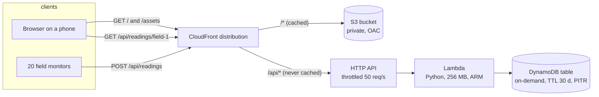

# Chapter 1 - Static site + API + DB: the "hello world" of architectures

*Every web product contains this shape somewhere. Learn to draw it, price it and break it before adding anything.*

This course is for developers who know one or two AWS services and want to design whole systems. Each chapter starts from a brief that could have come from a real client, draws a reference architecture, explains every service choice against its alternatives, prices it, lists the ways it fails, and gives you an infrastructure-as-code skeleton to synthesise and read. Nothing in the repo deploys itself; the skeleton is yours to deploy from your own account once you have read it.

The code is in [`examples/ch01/`](examples/ch01/). `make check` at the repo root lints it, runs 21 tests, synthesises the stack to CloudFormation and prints the cost table in section 5. Run it before reading further.

## 1. The brief

> A farmers' cooperative runs 20 environmental monitors in its members' fields. Each posts one temperature and humidity reading a minute. Members want a public web page, opened on a phone, showing the latest readings for any monitor. Today that might be 2 000 visits a day; the agriculture ministry may link to the page, which could mean a hundred times more. Readings older than 30 days are of no use. There are two developers and nobody whose job is operations. The monthly bill should be "less than a phone contract". A misbehaving monitor must never take the page down.

The brief already fixes most of the design. Pull the constraints out before touching a service:

| Constraint | What it rules out |
|---|---|
| Traffic unknown, could jump 100× | anything sized by hand: one EC2 instance, provisioned database capacity |
| Nobody runs servers | anything that needs patching or restarting |
| Under roughly $10 a month today | always-on databases; the cheapest RDS instance alone costs more |
| Readings expire after 30 days | keeping everything forever, the default of most stores |
| One bad device cannot break the site | devices writing unchecked into the store the page reads |
| Public, read-mostly page | anything that needs a login to see data |

The last two rows are worth a sentence about two real systems. The [queen-bee-incubator](https://github.com/Mariam-zeqred/queen-bee-incubator) and [smart-poultry-farm](https://github.com/Mariam-zeqred/smart-poultry-farm) repos both have an ESP32 writing directly to a Firebase Realtime Database with a database secret, and Flutter apps reading that database directly. Their READMEs say plainly that the database rules were open at prototype stage and that per-device authentication and locked-down rules are the path to production. This chapter deliberately avoids that shape: devices never touch the database. They go through an API that validates every reading, the page reads through the same API, and the database is private to one Lambda function.

## 2. Reference architecture



One CloudFront distribution is the only public hostname, with two origins. Static files (`/`, `/index.html`, later CSS and images) come from a private S3 bucket that only CloudFront may read, through an origin access control. Everything under `/api/*` goes to an API Gateway HTTP API, which invokes one Lambda function, which reads and writes one DynamoDB table.

Putting the API behind the same hostname as the page is the most useful trick in this chapter. The browser calls `/api/readings/field-1` on its own origin, so there is no CORS configuration, no API hostname baked into the front end, and one TLS certificate. A web application firewall, if you later need one, protects both with one attachment.

Walk a page load through the picture. A nearby edge has `index.html` cached, so S3 is not touched. The page's script fetches `/api/readings/field-1?limit=20`; the edge forwards it, query string included, to the HTTP API, which invokes the function, which runs one DynamoDB query, newest first. A monitor posting a reading takes the same `/api/*` path and ends in one `PutItem`.

## 3. Service choices and their alternatives

Every box in the diagram had alternatives. The rule used to pick: **when traffic is unknown and the team is small, choose what costs nothing when idle and whose capacity you do not have to guess.** Revisit it with a month of metrics, not before.

| Layer | Chosen | Also reasonable | Rejected for this brief, and why |
|---|---|---|---|
| Static files | S3 + CloudFront | Amplify Hosting: the same services wrapped with CI, if you want git-push deploys and do not need the API behind the same distribution | EC2 or Lightsail with nginx: patched and sized by hand |
| API | API Gateway **HTTP** API + Lambda | ALB + Fargate for long-running handlers or more than 10 GB of memory; App Runner if you already have a container | API Gateway **REST** API: 3.5× the price per request, for features this brief does not need (usage plans and API keys, request validation models, per-stage WAF) |
| Database | DynamoDB, on-demand | Aurora Serverless v2 when you need SQL joins; Timestream for pure time series with SQL | RDS on a fixed instance: always on, so it alone breaks the budget, plus backups, upgrades and a connection pool in front of Lambda |
| Compute shape | one function, three routes | one function per route when routes need different memory or permissions | a web framework inside Lambda: more code than the three routes |

Two of these deserve a word. DynamoDB fits because there is exactly one access pattern, "the newest N readings for one device": with the device id as partition key and the timestamp as sort key, that query reads one partition in order. Had the brief asked "which devices were above 30 °C last week", the answer would be a different table or database; design the table from the questions, never from the entities. And HTTP API over REST API is a choice many teams get backwards: the REST API has more features, and most APIs use none of them while paying for all of them.

## 4. Worked example: the skeleton, resource by resource

The whole stack is [`examples/ch01/stack.py`](examples/ch01/stack.py), 150 lines of AWS CDK in Python that synthesise to 26 CloudFormation resources. This section explains the lines that encode a decision.

**The table.** On-demand billing, point-in-time recovery, a TTL attribute, and a removal policy that depends on a flag:

```python
table = dynamodb.TableV2(
    self, "Readings",
    partition_key=dynamodb.Attribute(name="device", type=dynamodb.AttributeType.STRING),
    sort_key=dynamodb.Attribute(name="ts", type=dynamodb.AttributeType.NUMBER),
    billing=dynamodb.Billing.on_demand(),
    point_in_time_recovery_specification=dynamodb.PointInTimeRecoverySpecification(
        point_in_time_recovery_enabled=True
    ),
    time_to_live_attribute="expires",
    removal_policy=data_policy,  # RETAIN if retain_data, else DESTROY
)
```

The TTL is how "readings older than 30 days are of no use" becomes free: the API stamps every item with `expires = ts + 30 days`, and DynamoDB deletes expired items for nothing, usually within a couple of days. Point-in-time recovery costs a fraction of a cent here and turns "someone ran a bad script" from a lost product into a bad day. The `retain_data` flag exists because `cdk destroy` on a table marked `DESTROY` deletes the data; the repo defaults to `DESTROY` so the demo tears down cleanly, and exercise 5 asks what happens when you flip it.

**The function and its logs.** 256 MB on ARM, a 10 second timeout, and an explicit log group:

```python
log_group = logs.LogGroup(self, "ApiLogs", retention=logs.RetentionDays.ONE_MONTH, ...)
handler = lambda_.Function(
    self, "ApiHandler",
    runtime=lambda_.Runtime.PYTHON_3_12,
    architecture=lambda_.Architecture.ARM_64,
    memory_size=256,
    timeout=cdk.Duration.seconds(10),
    environment={"TABLE_NAME": table.table_name},
    log_group=log_group,
)
table.grant_read_write_data(handler)
```

Without the explicit log group, Lambda creates one that never expires, and a chatty handler quietly accumulates a storage bill for years. ARM is about 20 % cheaper per GB-second than x86 at the list prices in `prices.json`, and pure Python does not care which it runs on. `grant_read_write_data` writes an IAM policy naming this one table: the function cannot read any other table in the account, which is what least privilege means in practice.

**The routes and the throttle.** Three routes share one integration, and the stage is created by hand so that it can carry a throttle:

```python
apigw.HttpStage(
    self, "ApiStage", http_api=api, stage_name="$default", auto_deploy=True,
    throttle=apigw.ThrottleSettings(rate_limit=50, burst_limit=100),
)
```

Fifty requests a second is 4.3 million a day, far above the brief's traffic, and it caps the damage from a front end that polls in a loop or a firmware that retries without backoff. The throttle costs nothing; without it the Lambda and DynamoDB lines in the bill have no ceiling.

**The bucket and the distribution.** The bucket blocks all public access and refuses plain HTTP; CloudFront reaches it through an origin access control, the current replacement for origin access identities. The distribution has a default behaviour for the bucket and one more for `/api/*`:

```python
"/api/*": cloudfront.BehaviorOptions(
    origin=origins.HttpOrigin(api_domain),
    allowed_methods=cloudfront.AllowedMethods.ALLOW_ALL,
    cache_policy=cloudfront.CachePolicy.CACHING_DISABLED,
    origin_request_policy=cloudfront.OriginRequestPolicy.ALL_VIEWER_EXCEPT_HOST_HEADER,
)
```

Two of these lines are bug fixes in advance. `CACHING_DISABLED` stops the edge serving one member's readings to the next member for 24 hours, which the default cache policy would do to a `GET`. `ALL_VIEWER_EXCEPT_HOST_HEADER` forwards the query string (so `?limit=20` arrives) but not the `Host` header, which API Gateway would reject.

One line that is *not* in the stack is also instructive. A first draft set `minimum_protocol_version` to TLS 1.2; the CDK CLI warned that with the default `*.cloudfront.net` certificate the TLS policy is fixed and the setting is ignored. Only a custom domain with your own certificate lets you choose it (exercise 4). Synthesis caught that; a deploy would have kept the line and done nothing with it.

**The handler.** [`examples/ch01/lambda/handler.py`](examples/ch01/lambda/handler.py) is 120 lines of standard library plus boto3. The part worth reading is validation:

```python
DEVICE_RE = re.compile(r"^[a-z0-9][a-z0-9-]{1,31}$")
LIMITS = {"temp": (-40.0, 85.0), "hum": (0.0, 100.0)}  # the sensor's own range
```

A reading with a malformed device id, a missing field, a non-numeric value or a value the sensor cannot physically produce gets a `400` with a message, and nothing is written. This is what keeps a broken monitor from polluting the table. The function takes the table as a parameter so that `tests/test_handler.py` can run every route against an in-memory fake, in milliseconds, with no AWS account.

**What `make check` proved and did not.** The tests assert the public-access block, the two origins, the disabled API cache, the throttle, the TTL, the log retention and the removal-policy flag, and run the handler against a fake table. Nothing was deployed, so nothing proved that IAM lets CloudFront read the bucket or that the query works against real DynamoDB. Deploying is three commands you run yourself, listed in [`examples/ch01/README.md`](examples/ch01/README.md).

## 5. What it costs

The table below is printed by `examples/ch01/cost.py` from the assumptions in that file and the list prices in `prices.json`, which were copied from the AWS Price List API on 2026-10-13 for US East (N. Virginia), first pricing tier, with no free-tier allowance applied. Assumptions: 12 static objects and 1.2 MB per visit, 3 API calls per visit of about 4 kB each, a 120 ms handler at 256 MB, 20 devices posting once a minute, 30 days of retention.

| Line item | small (2,000/day) | busy (200,000/day) |
|---|---:|---:|
| CloudFront data transfer | $6.18 | $618.12 |
| CloudFront requests | $0.90 | $90.00 |
| API Gateway (HTTP API) | $0.18 | $18.00 |
| Lambda requests | $0.04 | $3.60 |
| Lambda duration (ARM) | $0.07 | $7.20 |
| DynamoDB writes | $0.54 | $0.54 |
| DynamoDB reads | $0.01 | $1.12 |
| DynamoDB storage + PITR | $0.02 | $0.02 |
| S3 storage | $0.00 | $0.00 |
| Route 53 hosted zone | $0.50 | $0.50 |
| **Total / month** | **$8.44** | **$739.11** |

Three things to take from it. At today's traffic the design costs less than a phone contract. At a hundred times the traffic the bill is 84 % data transfer: 1.2 MB per visit, six million times. Compute, the part engineers optimise first, is $29 of $739, so the first optimisation here is a smaller page, not a faster function; exercise 1 puts a number on it. The device side (writes, storage) does not move between the columns at all.

The free tier would remove most of the small column (CloudFront, Lambda and DynamoDB have always-free allowances; check the current pages, as AWS restructured the free tier in 2025). The model leaves it out on purpose: a design should be affordable at list price, because your production account is rarely the one that qualifies.

## 6. How it fails

| Failure | What the member sees | What already limits it | What you would add next |
|---|---|---|---|
| Bug in the handler, unhandled exception | API returns 500; the page loads and shows "Error" | the two origins fail independently, the static page still serves | a CloudWatch alarm on the function's `Errors` metric |
| A client polls in a tight loop | `429` for everyone during the burst | the 50 req/s stage throttle | per-route throttles so devices and humans do not share one bucket (exercise 3) |
| New `index.html` deployed, phones still see the old one | stale page for up to 24 h | `BucketDeployment` invalidates `/*` after each upload | hashed asset filenames, so only `index.html` needs invalidating |
| `/api/*` accidentally cached | one member sees another device's readings | `CACHING_DISABLED` on that behaviour, asserted by a test | nothing; the test is the guard |
| Someone makes the bucket public "to debug" | nothing visible; the bucket is listable from the internet | `BLOCK_ALL` plus the OAC policy; the next deploy reverts console changes | an AWS Config rule for public buckets |
| Someone deletes data with a bad script | readings vanish | point-in-time recovery: restore to any second in the last 35 days | an alarm on an unusual delete rate |
| The whole region is unavailable | API down; cached static page still serves from edges | CloudFront is global | nothing for this brief; chapter 5 is about when and how to go multi-region |

Notice the third column: almost every row is already limited by one cheap or free line in the stack. Architecture review is mostly this, walking the table and checking that each failure has a line.

## 7. Exercises

1. **The ministry links.** The ministry's link brings 2 000 000 visits a day. Add a `Scenario` to `cost.py` for it, once with the current 1.2 MB pages and once with the page trimmed to 300 kB. What is the monthly cost in each case, and which single line item dominates? Where does the first-tier-only pricing in `prices.json` over-estimate?
2. **A confused monitor** posts `{"device": "field-7", "temp": 22.456, "hum": "55%"}`. What status code does it get back, what is stored, and what would be stored if `hum` were `55`?
3. **Separate throttles.** Devices and phones share the 50 req/s throttle, so a buggy front end can starve the monitors. Give `POST /api/readings` its own 20 req/s, burst 40, without changing the default. Hint: the L2 `HttpStage` exposes only the default settings; look at `node.default_child`.
4. **A real domain.** The cooperative buys `coop.example`. What changes in the stack to serve the site there with TLS 1.2 as the minimum, and what does it add to the bill?
5. **Retained data.** Deploy with `-c retain_data=true`, `cdk destroy`, deploy again. What exists in the account at each step, and why does the new stack not see the old readings?

<details>
<summary>Answers</summary>

**1.** `Scenario("ministry", visits_per_day=2_000_000, bytes_per_visit=300_000)` gives about $2 790 a month ($1 590 data transfer, $900 CloudFront requests); with 1.2 MB pages the same traffic costs about $7 380. Page weight beats every other optimisation combined. `prices.json` holds only the first tier, so above 10 TB a month (the trimmed case moves 18 TB) the real transfer rate drops to $0.080 per GB, and the Lambda and API lines also have lower tiers; the model over-estimates by a few percent, in the safe direction.

**2.** `400` with `{"error": "hum must be a number"}`, because `float("55%")` fails, and nothing is stored: `validate_reading` raises before `put_item`. With `hum: 55` the stored item is `device="field-7"`, `temp=Decimal("22.46")` (two decimals; DynamoDB has no float type and the sensor has no third decimal), `hum=Decimal("55.0")`, `ts` set to server time because none was sent, and `expires = ts + 2 592 000`.

**3.** The CloudFormation stage resource supports per-route settings that the L2 construct does not surface. Reach the L1 and set them:

```python
stage = apigw.HttpStage(self, "ApiStage", ..., throttle=apigw.ThrottleSettings(rate_limit=50, burst_limit=100))
cfn_stage = stage.node.default_child
cfn_stage.route_settings = {
    "POST /api/readings": {"ThrottlingRateLimit": 20, "ThrottlingBurstLimit": 40},
}
```

The key is the route key as API Gateway names it: method, space, path. The template then carries both `DefaultRouteSettings` and `RouteSettings` (checked by synthesising it). When an L2 construct lacks a property, `node.default_child` is the escape hatch to the full CloudFormation resource.

**4.** Four changes and one gotcha. A Route 53 public hosted zone for `coop.example`. An ACM certificate validated against that zone, which for CloudFront must live in `us-east-1` whatever region the stack is in. On the distribution, `domain_names=["coop.example"]` and `certificate=cert`; now `minimum_protocol_version=TLS_V1_2_2021` takes effect, because the policy belongs to your certificate. And a Route 53 `ARecord` aliased to the distribution; alias queries are free. Cost: the $0.50 hosted zone already in the table; the certificate is free. The gotcha is the region: a stack in `eu-central-1` needs a second stack, or a cross-region construct, for the certificate.

**5.** After the first deploy there is a table with a generated name like `Ch01HelloStack-ReadingsXXXX`. `cdk destroy` deletes everything except that table, because its `DeletionPolicy` is `Retain`. The second deploy creates a *new* table with a new generated name, and `TABLE_NAME` points at the new, empty one; the old table still exists and still bills for storage. That is the point of `Retain`: nothing is lost, but nothing is reconnected either. To adopt the old data, import the table into the new stack with `cdk import`, or reference it with `TableV2.from_table_name`, or copy the items across. Production stacks should set `retain_data=true` and an explicit `table_name` so this story has one table in it.

</details>

## What to read next

- **AWS Well-Architected Framework, Serverless Applications Lens.** The six pillars applied to this kind of stack; chapter 6 maps every design in this course back to them.
- **AWS CDK Developer Guide, "Working with the AWS CDK in Python"**, and the `aws_cdk.aws_cloudfront_origins` API reference for origin access control and the managed policies used here.
- **Amazon DynamoDB Developer Guide, "Best practices for designing and using partition keys"**: why `device` is the right partition key here and when it would not be.
- **CloudFront Developer Guide, "Restricting access to an Amazon S3 origin"**: what origin access control does and the bucket policy it needs.
- **Chapter 2, IoT telemetry at scale**, which replaces `POST /api/readings` with AWS IoT Core and asks what changes at 100 000 monitors instead of 20.
