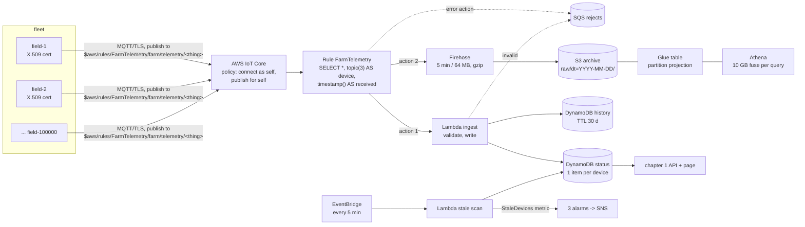

# Chapter 2 - IoT telemetry at scale: what changes between 20 and 100 000 devices

*Chapter 1 let devices `POST` to an API. This chapter gives each device an identity, a persistent connection and two destinations for every reading, then asks which lines of the bill grow when the fleet does.*

The code is in [`examples/ch02/`](examples/ch02/). `make check` at the repo root lints it, runs its 28 tests (49 with chapter 1), synthesises the stack to CloudFormation and prints the three cost tables in section 5. Run it before reading further.

## 1. The brief

> The cooperative's 20 monitors from chapter 1 worked, and the agriculture ministry wants the same thing nationally: 1 000 monitors by next season, up to 100 000 in three years. Each still posts temperature and humidity once a minute. Agronomists want the latest reading per field within seconds, the last 30 days of readings on demand, and every raw reading kept for years for research queries in SQL. A stolen or cloned monitor must not be able to report as another field. A monitor that goes quiet must be noticed within ten minutes. The team is still two developers. The budget is "cents per device per month".

The differences from chapter 1 are not only about volume:

| Constraint | What it rules out |
|---|---|
| 100 000 devices, one message a minute each | anything billed per device-alarm, per connection on a server you run, or per API call at API Gateway prices |
| A device may only ever report as itself | one shared API key or database secret for the whole fleet |
| "Latest within seconds" and "30 days on demand" and "years in SQL" | one store for all three; each is a different access pattern with a different price |
| Noticed within ten minutes | the obvious fix, one CloudWatch alarm per device, which section 5 prices at $22 000 a month |
| Cents per device per month | a per-message Lambda plus on-demand writes at 100 000 devices; both are right at 20 and wrong at 100 000 |
| Two developers | a self-hosted MQTT broker, a Kafka cluster, anything with a pager |

The second row is the one the two real systems linked in chapter 1 get wrong, by their own account. The [queen-bee-incubator](https://github.com/Mariam-zeqred/queen-bee-incubator) README says the firmware is configured with "your Firebase database URL and a database secret" and writes over "HTTPS (TLS-pinned)" to `/devices/<hive-id>/`, draining a "60-reading ring buffer ... once a minute"; its security note says to "write rules that confine each device to `/devices/<its name>`" before any unit controls a real heater. The [smart-poultry-farm](https://github.com/Mariam-zeqred/smart-poultry-farm) README says the firmware "authenticates with a legacy database secret and skips TLS certificate verification", that the database rules "for this prototype are open", and that "the path forward is per-device auth tokens, CA pinning and locked-down database rules". That path forward is exactly this chapter's identity model: one certificate per device, and a policy that names the device.

## 2. Reference architecture



A device connects to AWS IoT Core over MQTT with TLS, authenticated by its own X.509 certificate. It publishes to a *Basic Ingest* topic, `$aws/rules/FarmTelemetry/farm/telemetry/field-1`: the `$aws/rules/<rule>` prefix sends the message straight to one rule and skips the publish/subscribe broker, which is why the messaging line of the bill is zero in section 5. The rule's SQL adds two fields the device cannot forge, its thing name from the topic and the broker's clock, then runs two actions: invoke the ingest function (hot path) and append to a Firehose stream (cold path). If either action fails, the message goes to a queue instead of disappearing.

The hot path writes two tables. *Status* has one item per device, overwritten by each reading, and is what chapter 1's API and page read: "latest within seconds". *History* has one item per reading with a 30-day TTL: "the last 30 days on demand", one query per device. The cold path batches messages into gzip objects under a date prefix in S3, which a Glue table describes and Athena queries in SQL: "years, for research". Three stores, three questions, three prices.

Walk one reading through. `field-1` publishes `{"temp": 22.4, "hum": 55, "ts": 1792108800}`. The rule turns it into `{..., "device": "field-1", "received": 1792108800412}`. The ingest function checks the values against the sensor's range, puts a history item with `expires = ts + 30 days`, and puts the status item *only if* its `ts` is newer than the one stored. Firehose holds the line in its buffer and, within five minutes, writes it with a few thousand neighbours into `raw/dt=2026-10-16/…gz`. Five minutes later the stale scan reads every status item, counts the ones older than ten minutes, and publishes that one number as a metric.

## 3. Service choices and their alternatives

The rule from chapter 1, *choose what costs nothing when idle and whose capacity you do not have to guess*, still picks the shape at 20 devices. This chapter adds a second rule for the brief's growth: **before choosing a per-something price, multiply it by 100 000.**

| Layer | Chosen | Also reasonable | Rejected for this brief, and why |
|---|---|---|---|
| Ingress | AWS IoT Core, MQTT over TLS, Basic Ingest | HTTPS `POST` to API Gateway (chapter 1) for devices that cannot hold a connection; IoT Core's own HTTPS publish endpoint for the same | a self-hosted broker (Mosquitto, EMQX) on EC2: patching, certificates and a pager for two developers; Kinesis Data Streams directly from devices: needs AWS credentials on every device |
| Identity | one X.509 certificate per device, one fleet policy with `${iot:Connection.Thing.ThingName}` | Cognito identities for devices that have a user; custom authorizers for legacy token schemes | one shared key or secret for the fleet, which the two real repos' own READMEs list as the thing to fix |
| Fan-out | one topic rule with two actions and an error action | the DynamoDBv2 rule action writing history with no function at all (exercise-worthy; it cannot do the conditional status write) | the device publishing twice, or the function forwarding to Firehose itself: twice the messages or a function on the cold path's critical path |
| Hot store | DynamoDB, two tables (status, history with TTL) | one table with a `LATEST` sort key; Timestream for pure time series in SQL | a relational database: 1 667 inserts a second at 100 000 devices is a sizing exercise, not a product feature |
| Cold store | Firehose → S3 (gzip JSON, daily prefix) → Glue → Athena | Parquet conversion in Firehose for 5–10× cheaper queries (what the companion repo does); Timestream or OpenSearch if queries are frequent and interactive | keeping it all in DynamoDB: $0.25 per GB-month against $0.023, and no SQL |
| Watchdog | one scheduled scan, one fleet metric, three alarms | per-device alarms up to a few hundred devices, where $0.40 each is nothing | per-device alarms at 100 000 devices: $22 000 a month, more than twice the rest of the design |

Two rows need a sentence. The identity row is a policy, not a service: IoT Core policies can refer to the thing a certificate is attached to, so one policy document serves the whole fleet and still names exactly one topic per device. And the hot-store row splits status from history on purpose. They have different sizes (100 000 items against four billion), different lifetimes (overwritten against expiring), and different readers (a page against an agronomist); one table could hold both, but then every "latest" query would pay to skip history, and the status items would need a TTL exemption.

The [aws-iot-telemetry-pipeline](https://github.com/Mariam-zeqred/aws-iot-telemetry-pipeline) repo by the same author is a fuller build of this shape: Parquet conversion, a status API and dashboard, a simulator that replays a real hour of incubator data. Its cost script is also where the watchdog finding came from: in its design, per-device CloudWatch metrics and alarms were about $700 of a $1 350 monthly bill at 1 000 devices, and its TODO lists the scheduled scan used here as the fix.

## 4. Worked example: the skeleton, resource by resource

The whole stack is [`examples/ch02/stack.py`](examples/ch02/stack.py), about 450 lines of AWS CDK in Python that synthesise to 41 CloudFormation resources (two of the three Lambda functions are the chapter's; the third is the CDK's bucket-emptying helper). This section explains the lines that encode a decision.

**The policy.** One document for the fleet, two statements, no wildcard resources:

```python
{"Effect": "Allow", "Action": "iot:Connect",
 "Resource": "arn:aws:iot:<region>:<account>:client/${iot:Connection.Thing.ThingName}",
 "Condition": {"Bool": {"iot:Connection.Thing.IsAttached": "true"}}},
{"Effect": "Allow", "Action": "iot:Publish",
 "Resource": "arn:aws:iot:<region>:<account>:topic/$aws/rules/FarmTelemetry/farm/telemetry/${iot:Connection.Thing.ThingName}"},
```

`${iot:Connection.Thing.ThingName}` is resolved by IoT Core at connection time to the name of the thing the certificate is attached to. A device may connect only with its own name as the MQTT client id, and publish only to its own topic; a certificate that is not attached to any thing may not connect at all. There is no `iot:Subscribe`: monitors do not need to hear anything in this chapter. A test asserts all of this from the template, including that no statement's resource is `*`.

**The rule.** One SQL statement and three places for a message to go:

```python
sql="SELECT *, topic(3) AS device, timestamp() AS received FROM 'farm/telemetry/+'",
actions=[LambdaAction(function_arn=ingest.function_arn),
         FirehoseAction(delivery_stream_name=stream.ref, role_arn=..., separator="\n")],
error_action=SqsAction(queue_url=rejects.queue_url, ...),
```

The `FROM` clause names `farm/telemetry/+` even though devices publish to `$aws/rules/FarmTelemetry/farm/telemetry/+`: Basic Ingest removes the prefix before the SQL sees the topic, so `topic(3)` is the thing name. Because the policy only lets `field-1` publish on `.../field-1`, `device` in the payload is authenticated, not claimed. The Firehose action's separator makes the archive one JSON object per line, which is what the Glue SerDe expects. Without the error action, a throttled function or a full stream drops the message and the only evidence is a CloudWatch metric nobody is watching.

**The ingest function.** [`examples/ch02/lambda/ingest.py`](examples/ch02/lambda/ingest.py) is about 140 lines of standard library, boto3 imported lazily so the tests never need it. Validation is chapter 1's, with one addition for clocks:

```python
if ts > received_s + MAX_FUTURE_S or ts < received_s - MAX_AGE_S:
    record["clock"] = "server"
    ts = received_s
```

Devices have bad clocks: a monitor that boots before NTP reports 1970, one with a drifted RTC reports next week. The function keeps the broker's time alongside the device's, falls back to it when the device's is implausible, and marks the record with the clock it believed. The other decision is the status write:

```python
status_table.put_item(Item=record,
    ConditionExpression="attribute_not_exists(ts) OR ts < :ts",
    ExpressionAttributeValues={":ts": record["ts"]})
```

MQTT at QoS 1 may deliver a message twice, and a device that buffered readings offline will send old ones after new ones. The conditional write means the status can only move forward in time; a redelivery or a late backlog reading fails the condition and is ignored, while the history table, keyed by `(device, ts)`, stores both without duplication. The tests run ten such cases against a fake table.

**The cold path.** Firehose buffers for 300 seconds or 64 MB, compresses with gzip and writes under `raw/dt=!{timestamp:yyyy-MM-dd}/`, with failed records under `errors/`. The Glue table over that prefix uses *partition projection*: instead of a crawler discovering each day's folder, the table's properties say `dt` is a date from `2026-01-01` to `NOW`, and Athena computes the paths. A query with `WHERE dt = '2026-10-16'` reads one day; the Athena workgroup's `bytes_scanned_cutoff_per_query` of 10 GB kills a query without a `dt` filter before it scans the whole archive, which at 100 000 devices would cost $5 per terabyte of the 1.2 TB it holds after a year.

**The watchdog.** [`examples/ch02/lambda/stale_scan.py`](examples/ch02/lambda/stale_scan.py) runs every five minutes from an EventBridge schedule, scans the status table with a projection of two attributes, and publishes one number:

```python
{"Namespace": "FarmTelemetry",
 "MetricData": [{"MetricName": "StaleDevices", "Value": stale_count, "Unit": "Count"}]}
```

There is deliberately no `Dimensions` entry naming the device: a dimension per device would make this one metric per device again, which is the bill the design is avoiding. The stale device names go to the function's log instead, and the alarm fires when the count is above zero for two consecutive scans, so one late message does not page anyone. `treat_missing_data=BREACHING` makes a scan that never ran into an alarm too. A test synthesises the stack with 50 things and asserts there are still exactly three alarms.

**What changes between 20 and 100 000.** Nothing in the diagram, and seven things in the parameters:

| Concern | At 20 devices | At 100 000 devices |
|---|---|---|
| Creating things and certificates | by hand, as the README shows | fleet provisioning: the device presents a claim certificate and gets its own, with the thing created from a template |
| Certificate rotation and revocation | a console click | a job, and a `RuleNotFound`/connect-failure metric to catch devices left behind |
| Hot-table billing | on-demand, $1.08 a month | provisioned with auto scaling: the load is flat by construction (every device on a one-minute clock), and provisioned writes cost 2.9× less at the same rate |
| Messages per reading | one | batch five readings per message where five minutes of status latency is acceptable; every per-message line falls 5× (section 5) |
| The ingest function | 20 invocations a minute | 1 667 a second, about 135 concurrent at 80 ms; fine for Lambda, but $2 000 a month, so the DynamoDBv2 rule action for history and a smaller function for status start to pay |
| The watchdog scan | reads 20 items | reads 15 MB every five minutes ($2 a month); at a million devices it needs an index (exercise 5) |
| Athena | any query is small | partition by day *and* filter by it; convert to Parquet so a column scan reads 1/10 of the bytes |

## 5. What it costs

The tables are printed by [`examples/ch02/cost.py`](examples/ch02/cost.py) from the assumptions in that file and the list prices in `prices.json`, copied from the AWS Price List API on 2026-10-16 for US East (N. Virginia), with offer versions recorded. Assumptions: one 120-byte reading a minute per device, always connected, an 80 ms handler at 256 MB, 160-byte history items for 30 days, 12 months of gzip archive at 5:1, 100 Athena queries a month each reading one day, a scan every five minutes. No free tier is applied. Only IoT messaging and CloudWatch metrics are priced across tiers; every other line is first tier, which over-estimates slightly in the safe direction.

| Line item | 20 devices | 1 000 devices | 100 000 devices |
|---|---:|---:|---:|
| IoT Core connection minutes | $0.07 | $3.46 | $345.60 |
| IoT Core messaging | $0.00 | $0.00 | $0.00 |
| IoT Core rules triggered | $0.13 | $6.48 | $648.00 |
| IoT Core actions (Lambda + Firehose) | $0.26 | $12.96 | $1,296.00 |
| Lambda requests | $0.17 | $8.64 | $864.00 |
| Lambda duration (ARM) | $0.23 | $11.52 | $1,152.01 |
| DynamoDB writes | $1.08 | $54.00 | $5,400.00 |
| DynamoDB storage + status PITR | $0.03 | $1.73 | $172.81 |
| Firehose ingestion (5 KB minimum) | $0.13 | $6.41 | $641.43 |
| S3 archive (12 months) + puts | $0.05 | $0.33 | $28.66 |
| Athena queries | $0.00 | $0.02 | $1.73 |
| Watchdog: 3 alarms, 1 metric, scans, rejects | $0.63 | $0.67 | $4.45 |
| CloudWatch Logs | $0.07 | $3.43 | $343.44 |
| **Total / month** | **$2.85** | **$109.65** | **$10,898.12** |
| per device / month | $0.1427 | $0.1096 | $0.1090 |

Four things to take from it. The design scales linearly: eleven cents per device a month at every size, which meets the brief; the fixed part is 60 cents. Half the bill at scale is DynamoDB writes: two write units per reading, 8.6 billion a month, at the on-demand price. The messaging line is zero because of Basic Ingest; exercise 1 shows what it would be. And Firehose bills 5 120 bytes for a 120-byte record, so the cold path costs 43× its data volume, which is the first thing batching fixes.

The second table, condensed from the one `cost.py` prints, applies the two changes from the end of section 4 to the 100 000-device fleet:

| Line item | 100 000 devices | 100 000, batched x5 | 100 000, batched x5 + provisioned |
|---|---:|---:|---:|
| IoT Core connection minutes | $345.60 | $345.60 | $345.60 |
| IoT Core rules triggered | $648.00 | $129.60 | $129.60 |
| IoT Core actions (Lambda + Firehose) | $1,296.00 | $259.20 | $259.20 |
| Lambda requests + duration | $2,016.01 | $403.20 | $403.20 |
| DynamoDB writes | $5,400.00 | $3,240.00 | $1,123.20 |
| Firehose ingestion (5 KB minimum) | $641.43 | $128.29 | $128.29 |
| CloudWatch Logs | $343.44 | $68.69 | $68.69 |
| storage, archive, Athena, watchdog (unchanged) | $207.65 | $207.65 | $207.65 |
| **Total / month** | **$10,898.12** | **$4,782.22** | **$2,665.42** |
| per device / month | $0.1090 | $0.0478 | $0.0267 |

Batching five readings per message cuts every per-message line by five and the bill by more than half; it costs five minutes of status latency, which the brief's "within seconds" has to negotiate. Provisioned capacity for the two tables (2 400 write units with 20 % headroom) cuts the writes line by another 2.9×. Neither change touches the architecture diagram. The order matters: provisioned capacity at 20 devices would cost more than on-demand and lock in a guess; batching at 20 devices would save 20 cents.

The third table is the watchdog decision on its own:

| Watchdog design | 20 devices | 1 000 devices | 100 000 devices |
|---|---:|---:|---:|
| one alarm + one metric per device | $8.00 | $400.00 | $22,000.00 |
| this chapter: 3 alarms + 1 fleet metric (scans priced above) | $0.60 | $0.60 | $0.60 |

At 20 devices the per-device design is fine and simpler to read in the console. At 100 000 it costs twice the rest of the system. The scan replaces a per-device price with a per-byte one, and bytes are the cheap axis.

## 6. How it fails

| Failure | What you see | What already limits it | What you would add next |
|---|---|---|---|
| A certificate is copied from a stolen monitor | fake readings for *that* field only; the real monitor is disconnected whenever the clone connects with its client id | the policy: it cannot connect as, or publish for, any other thing | revoke the certificate; alarm on IoT lifecycle `disconnected` events with reason `DUPLICATE_CLIENTID` (exercise 2) |
| Firmware bug sends `hum: "55%"` from the whole fleet | status stops updating; the rejects queue fills | validation rejects, the queue keeps the evidence, `RejectsAlarm` fires at 10 messages | a per-reason metric from the function so the alarm says *which* bug |
| The ingest function is throttled or throws | the hot path misses readings | the rule's error action: the message lands in the rejects queue with the error, and `IngestErrorsAlarm` fires | reserved concurrency on the function, and a replay script from the queue |
| Message delivered twice (QoS 1 redelivery) | nothing in DynamoDB; a duplicate line in the archive | history is keyed by `(device, ts)`; status only moves forward | `SELECT DISTINCT` or a dedupe step before research queries (exercise 3) |
| A device's clock is wrong | readings in 1970 or next year | the `received` field and the fallback to broker time, marked `clock = "server"` | an alarm on the fraction of server-clocked records |
| Firehose cannot write to the bucket | archive stops growing; the hot path is unaffected | Firehose retries for 24 hours, then writes to `errors/`, and logs to CloudWatch | an alarm on the stream's `DeliveryToS3.Success` metric |
| A research query has no `dt` filter | the query is cancelled | the workgroup's 10 GB cutoff | Parquet conversion so a full scan is 10× smaller anyway |
| The watchdog function is broken | no `StaleDevices` metric | `treat_missing_data=BREACHING`: no data is an alarm | nothing; this is the point of that line |
| The whole region is unavailable | devices cannot connect; buffered readings arrive later with their own `ts` | the firmware's ring buffer, if it has one, and the history key that accepts late readings | nothing for this brief; chapter 5 |

Again the third column: the error action, the conditional write, the `received` field and the missing-data setting are one line each, and each turns a silent loss into a visible, bounded one.

## 7. Exercises

1. **The messaging line.** Set `basic_ingest=False` in `cost.py` and print the tables. What does the IoT Core messaging line become at each fleet size, and what does a fleet give up by using Basic Ingest?
2. **A cloned certificate.** Someone copies `field-3`'s certificate and key to a laptop. List exactly what the laptop can and cannot do against this stack, what the real `field-3` experiences, and the two commands that end it.
3. **Duplicates in the archive.** A QoS 1 redelivery puts the same reading into the S3 archive twice. Write the Athena query over `farm_telemetry.raw` that counts duplicated `(device, ts)` pairs for one day, and explain why the same event leaves no trace in either DynamoDB table.
4. **The 5 KB minimum.** At 100 000 devices the Firehose line is $641 for 518 GB of data. How many bytes is Firehose billing, how many readings per message would make the rounding disappear, and why is that number unacceptable for this brief?
5. **A million devices.** The stale scan reads the whole status table every five minutes. Price that at 1 000 000 devices with the model's constants, then design a DynamoDB index so the scan reads only stale items. Why can the table's TTL feature not be used as the ten-minute timer?

<details>
<summary>Answers</summary>

**1.** Printing with `basic_ingest=False` gives $0.86, $43.20 and $3 656.00: messages are $1.00 per million for the first billion and $0.80 per million for the next four billion, so 4.32 billion messages cost $1 000 + $2 656. That is a third of the reference design's bill at 100 000 devices, for one topic prefix. What Basic Ingest gives up is the broker: nothing else can subscribe to `farm/telemetry/#`, so a live debugging console or a second consumer must read from the rule's outputs (the status table, the archive) rather than from the topic. For a fleet that only reports, that is no loss.

**2.** The laptop can connect, but only with client id `field-3` (the `iot:Connect` resource is the thing name), and can publish only to `$aws/rules/FarmTelemetry/farm/telemetry/field-3`. Publishing to `.../field-4` or connecting as `field-4` is denied, and IoT Core disconnects a client that publishes to a topic its policy does not allow. So the attacker can forge `field-3`'s readings and nothing else. The real `field-3` is disconnected each time the clone connects with the same client id (the broker keeps one connection per client id), reconnects, and knocks the clone off in turn; that flapping is visible in the lifecycle events IoT Core publishes on `$aws/events/presence/disconnected/field-3`, whose `disconnectReason` is `DUPLICATE_CLIENTID`. It ends with `aws iot update-certificate --certificate-id <id> --new-status REVOKED` and a new certificate for the real device (`create-keys-and-certificate`, `attach-thing-principal`, `attach-policy`, as in the README).

**3.**

```sql
SELECT device, ts, count(*) AS copies
FROM farm_telemetry.raw
WHERE dt = '2026-10-16'
GROUP BY device, ts
HAVING count(*) > 1;
```

The `dt` filter keeps the query inside one day's partition and the workgroup's 10 GB cutoff. In DynamoDB the redelivery leaves nothing: the history key is `(device, ts)`, so the second `put_item` overwrites the first with an identical item, and the status write's condition `ts < :ts` is false for an equal `ts`, so it is rejected and the function records "status kept". Only the archive, which is append-only by design, keeps both lines; that is why research queries over it should start with `SELECT DISTINCT` or the query above.

**4.** 4.32 billion records a month, each billed as 5 120 bytes: 22.1 TB billed for 0.52 TB sent, a factor of 42.7, which is $641 against $15. The rounding disappears at 5 120 / 120 = 42 readings per message, which at one reading a minute means a message every 42 minutes: the status table would be up to 42 minutes stale, against a brief that says "within seconds". So batching is a trade, not a fix: five per message costs five minutes of staleness and leaves a factor of 8.5. To remove the rounding without the latency, move the cold path off Direct PUT: a Kinesis Data Streams rule action with Firehose reading from the stream is billed by the gigabyte read (a separate usage type in the price list), and the hot path keeps its one-minute messages. Price that from the current Kinesis pricing page before choosing it; this chapter's `prices.json` does not include it.

**5.** A million 150-byte status items is 150 MB per scan, 18 311 eventually consistent read units, times 8 640 scans a month: 158 million read units, about $20 a month, and each scan takes minutes inside a function with a five-minute timeout. The fix is to read only what is stale. Add a global secondary index with partition key `shard` (the device name hashed to 0–99, written by the ingest function) and sort key `received`; the scan becomes 100 `Query` calls with `received < :cutoff`, each returning only the silent devices in that shard, so the cost is proportional to stale devices, not to the fleet. TTL cannot be the timer because DynamoDB's TTL deletes expired items in the background "within a few days" of expiry, not at it; a presence item expiring at ten minutes could still be there at midnight, and the brief says ten minutes.

</details>

## What to read next

- **AWS IoT Core Developer Guide, "Reducing messaging costs with Basic Ingest"** and **"IoT Core policy variables"**: the two features this chapter's bill and security depend on, and the limits of each.
- **AWS IoT Core Developer Guide, "Provisioning devices that don't have device certificates using fleet provisioning"**: how 100 000 certificates get onto 100 000 devices without a person.
- **Amazon Data Firehose Developer Guide, "Dynamic partitioning"** and **"Converting your input record format"**: the two steps between this chapter's archive and the companion repo's Parquet one.
- **Amazon Athena User Guide, "Partition projection with Amazon Athena"**: why there is no crawler in this stack.
- **Amazon DynamoDB Developer Guide, "Read/write capacity mode"**: the on-demand versus provisioned decision, with the auto-scaling settings this chapter's tuned column assumes.
- **Chapter 3, batch ML training and inference on a schedule**, which takes the archive this chapter writes and trains on it.
