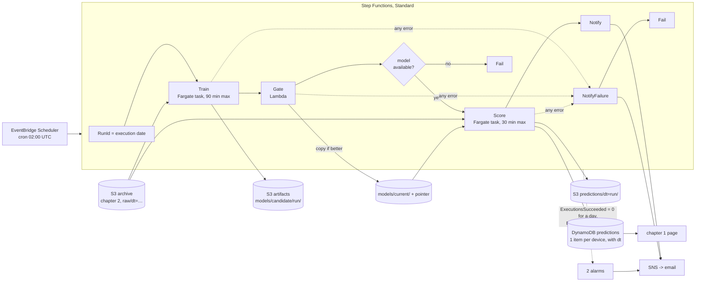

# Chapter 3 - Batch ML on a schedule: train every night, score every field, never ship a worse model

*Chapter 2 built an archive that grows by a million lines a day and nobody reads. This chapter reads it: a job that runs while the agronomists sleep, whose first design question is not which model but what happens when the job does not run.*

The code is in [`examples/ch03/`](examples/ch03/). `make check` at the repo root lints it, runs its 22 tests (71 with chapters 1 and 2), synthesises the stack, prints the cost tables in section 5 and then runs the whole pipeline on a synthetic archive: train, gate, score. Run it before reading further; the numbers in section 4 come from that run.

## 1. The brief

> The ministry's agronomists want, every morning by 06:00, a forecast of each field's peak temperature for the coming day and a flag on fields expected to pass 30 °C, so irrigation crews can be sent before the heat, not after. The forecast should improve as the archive grows, but a worse model must never replace a better one. If the job fails, the page must not present yesterday's forecast as today's. Two developers, no ML platform engineer, and the bill should stay in the tens of dollars a month for the 1 000-monitor fleet.

The constraints, and what each removes:

| Constraint | What it rules out |
|---|---|
| Ready by 06:00, once a day | anything real-time: an inference endpoint billed by the hour for predictions that change once a day |
| Must improve as the archive grows | a model trained once by hand and uploaded; training has to be part of the job |
| A worse model must never replace a better one | shipping whatever trained; the job needs a measured comparison and a gate |
| Yesterday's forecast must not look like today's | overwriting a prediction without saying which morning it belongs to; a failed run has to be visible, not silent |
| Two developers | a workflow engine to host (Airflow), a cluster to patch, a pager |
| Tens of dollars at 1 000 monitors | a managed notebook instance left on, an endpoint, anything priced by the hour while idle |

The forecasting question is modest on purpose: *the highest hourly temperature in the next 24 hours, per field, from the last 24 hourly means and the hour of day.* The chapter is about the machinery around a model, which is the same whether the model is this one or a network that trains for an hour; the model only changes the compute line, and section 5 prices three ways to run it.

## 2. Reference architecture



One execution a night, four steps, two buckets. The *archive* bucket is chapter 2's, read-only here. The *artifacts* bucket holds every candidate under its run id, the current model under one fixed prefix with a pointer file naming the run that produced it, and each morning's predictions under their date. Candidates expire after 30 days; the current prefix is versioned, so every model that was ever live can be recovered.

Walk one night through. At 02:00 UTC the scheduler starts an execution. Its first state computes the run id from the execution's start time, `2026-10-19`, and every key written tonight carries it. The training task reads the last 90 days of archive, aggregates readings into an hourly table, builds one example per device-hour, holds out the last seven days, fits a model on the rest, and scores three things on the hold-out week: the candidate, a "same as yesterday" baseline, and the current model from `models/current/`. It writes the candidate and a `metrics.json` with those numbers. The gate reads that file: the candidate must beat the baseline and be at least as good as the current model on the same rows; if so it is copied to `models/current/` and the pointer rewritten. The scoring task loads whatever is current, reads the last two days of archive, builds one row per device from its most recent 24 complete hours, and writes a prediction per device to DynamoDB (for the page) and S3 (for research), stamped with the run id and the hour it was computed from. An SNS message says which model was used and why; if any step throws, a different message says what failed and an alarm fires. If no execution succeeds in a day, for any reason including a disabled schedule, a second alarm fires without a failure to count.

## 3. Service choices and their alternatives

Chapter 1's rule, *choose what costs nothing when idle*, matters most here: this system is idle 23 hours a day. The rule this chapter adds: **a batch job's first failure mode is not running, so the design must notice silence.**

| Layer | Chosen | Also reasonable | Rejected for this brief, and why |
|---|---|---|---|
| Orchestration | Step Functions, Standard workflow | SageMaker Pipelines if the compute is SageMaker; a single Lambda calling the steps for a job that fits in 15 minutes | Express workflows: a five-minute limit and at-least-once execution, wrong for a 20-minute job that must run once; Airflow on MWAA: an environment billed by the hour, hundreds of dollars a month before the first task, for two developers |
| Training and scoring compute | one container on Fargate (ARM, 1 vCPU, 4 GB), two commands | Lambda at 20 devices, where training takes a minute (section 5); SageMaker Training for managed spot, GPUs and experiment tracking once the model needs them | EC2: an instance to patch and a pager; a SageMaker endpoint for scoring: real-time pricing for a once-a-day answer |
| Feature preparation | the task streams raw archive lines and aggregates in memory | Athena `UNLOAD` of the hourly table to Parquet, so the task reads 100× fewer bytes (the tuned design in section 5; `features.sql`) | Glue or EMR Spark: cluster start-up and minimum billing for a three-gigabyte job |
| Model store | an S3 prefix per candidate, one `current/` prefix with a pointer file, versioning on | SageMaker Model Registry if on SageMaker; a DynamoDB table of runs when there are many models | nothing (overwrite one file): no history, no way to say which model made which prediction |
| Prediction store | DynamoDB for the page, S3 for research, both with the run id | S3 only, with the page querying Athena: a two-second page for a one-row lookup | a real-time endpoint: wrong shape, and about $80 a month idle for the smallest instance |
| Trigger | EventBridge Scheduler, cron in an explicit time zone | an EventBridge rule with a cron (the older way, UTC only) | an execution that waits in a loop forever: one hung state and the schedule is gone |
| Gate | a Lambda comparing three MAEs on the same hold-out | a SageMaker model-quality check step if on SageMaker | no gate: the brief's "never replace a better model" needs a measurement, not hope |

Two rows need a sentence. The compute row picks Fargate over SageMaker not on price (under a dollar at 1 000 devices either way) but on what two developers have to learn: a Fargate task is a Dockerfile and an entry point, the same container runs on a laptop with a directory instead of a bucket, and the tests run it that way. SageMaker's training container contract (`/opt/ml/input`, `/opt/ml/model`) is the right thing to adopt the day the model needs a GPU, managed spot or a registry, and the pipeline code would move into it unchanged. The feature-preparation row is the one that changes with scale; section 5 shows where.

The two real systems from chapters 1 and 2 are where a job like this would eventually point. The [queen-bee-incubator](https://github.com/Mariam-zeqred/queen-bee-incubator) README says the firmware "logs every reading to an SD card and to Firebase"; the [smart-poultry-farm](https://github.com/Mariam-zeqred/smart-poultry-farm) README says its app "appends every new reading to `farm/sensors/history`". Both keep a history; neither README describes a model trained on it. If one were added, this chapter is its shape, with a Firebase export as the archive.

## 4. Worked example: the pipeline, the gate and the state machine

The stack is [`examples/ch03/stack.py`](examples/ch03/stack.py), about 330 lines of CDK that synthesise to 45 resources (two Lambda functions: the gate and the CDK's bucket-emptying helper). The pipeline is [`examples/ch03/pipeline/`](examples/ch03/pipeline/), about 450 lines of Python that run in the container and on a laptop.

**Streaming the archive.** [`archive.py`](examples/ch03/pipeline/archive.py) yields one `(device, ts, temp, hum)` tuple per line from each day's gzip objects, never a list, and [`features.py`](examples/ch03/pipeline/features.py) folds them into an hourly table as they arrive:

```python
def hourly_table(readings):
    table = {}
    for r in readings:
        hours = table.setdefault(r.device, {})
        hour = hours.get(r.ts // 3600) or hours.setdefault(r.ts // 3600, Hour())
        hour.add(r.temp)          # running total, count, min, max
    return table
```

A 1 000-device, 90-day window is 130 million lines but only 2.2 million hourly entries, so memory is set by the fleet, not by the window. The local run reports its parse rate; on this sandbox it was 313 940 lines a second, the constant section 5 is built on.

**Examples, and gaps.** An example is one device at the end of one hour: 24 lagged hourly means, the sine and cosine of the hour the forecast starts, and the target, the highest hourly maximum over the next 24 hours. If any lag hour is missing there is no example rather than an interpolated one; a Firehose outage shows up as fewer rows, not invented readings. At scoring time the same rule leaves a device with a gap in its last day unscored, and exercise 5 makes that visible.

**The split is by time.** [`model.py`](examples/ch03/pipeline/model.py) holds out the last seven days and trains on everything before them:

```python
cutoff = int(ex.hours.max()) - holdout_hours
test = ex.hours > cutoff
```

```mermaid
gantt
    title One night's run (run id 2026-10-19): what each step reads
    dateFormat YYYY-MM-DD
    axisFormat %d %b
    section Train
    fit the candidate on these rows                 :a, 2026-07-21, 2026-10-11
    hold-out week: candidate, baseline, champion    :crit, b, 2026-10-11, 2026-10-18
    section Score
    last 24 complete hours become the features      :c, 2026-10-17, 2026-10-18
    the forecast window (the target, unknown yet)   :active, d, 2026-10-18, 2026-10-19
```

A random split would put Tuesday 14:00 in the test set with Tuesday 13:00 and 15:00 in the training set, and the model would look far better than it is. Exercise 3 measures how much: on the synthetic archive a random 85/15 split reports a hold-out MAE of 0.54 °C where the time split reports 2.01 °C, the number a crew dispatched at 06:00 would experience.

**Three numbers on the same rows.** The training task also scores a baseline, *the same as yesterday* (the highest of the 24 lag means), and the current model if there is one, on the identical hold-out rows:

```python
mae=mae(model, ex.X[test], ex.y[test]),
baseline_mae=float(np.mean(np.abs(yesterday_baseline(ex.X[test]) - ex.y[test]))),
champion_mae=None if champion is None else mae(champion, ex.X[test], ex.y[test]),
```

Last night's model was judged on last night's hold-out week; tonight's is a different week, so comparing stored numbers would compare weather, not models. Re-scoring the champion tonight is one line.

**The gate.** [`lambda/gate.py`](examples/ch03/lambda/gate.py) is 150 lines, most of them two store classes. The decision is six lines:

```python
if metrics["mae"] > metrics["baseline_mae"]:
    return False, "candidate ... does not beat the yesterday baseline"
if metrics.get("champion_mae") is None:
    return True, "no current model"
if metrics["mae"] <= metrics["champion_mae"]:
    return True, "candidate ... <= current model on the same hold-out"
return False, "candidate ... is worse than the current model on the same hold-out"
```

Promotion is a copy to `models/current/` and a pointer file with the run id. The function returns `model_available`, all the state machine needs: a refused candidate is not a failure, the morning's forecast still comes from the current model, and the notification says why nothing changed. In the local run, a second training on 14 days instead of 21 produced a candidate with MAE 1.914 against the champion's 1.895, and the gate refused it.

**The state machine.** The run id is computed from the execution itself, so a manual start and a scheduled one behave the same:

```python
"run_id.$": "States.ArrayGetItem(States.StringSplit($$.Execution.StartTime, 'T'), 0)"
```

Each Fargate step uses the `RUN_JOB` integration pattern (`ecs:runTask.sync`), so the state waits for the container to exit and fails on a non-zero code; without it the workflow would race ahead the moment the task was *started*. Each task has its own timeout (90 and 30 minutes) inside the execution's three hours, the training step retries once on an ECS capacity error and never on a crash, and all three steps catch `States.ALL` into the failure notification. The task's result is discarded from the state: what it produced is in S3 under the run id, where the next step and a person both find it.

**Noticing silence.** `RunFailedAlarm` is obvious. `NoSuccessTodayAlarm` is the one that matters: `ExecutionsSucceeded` summed over a day, threshold 1, `treat_missing_data=BREACHING`, so a disabled schedule, a scheduler role without permission and an execution stuck inside its timeout all produce the same page.

**The local run.** `make ch03-run` writes a synthetic archive (10 devices, 21 days, 302 400 lines; the generator is [`synth_archive.py`](examples/ch03/pipeline/synth_archive.py) and nothing in it is measured from a field), then trains, gates and scores:

```
"lines": 302400, "read_seconds": 0.96, "lines_per_second": 313940,
"rows": 2890, "holdout_rows": 1680, "mae": 2.008, "baseline_mae": 2.673, "champion_mae": null
"promoted": true, "reason": "no current model; candidate MAE 2.008"
"devices_scored": 10, "devices_over_threshold": 5, "threshold_c": 30.0
```

The model beats yesterday by 0.66 °C on synthetic weather whose day-to-day change is a random walk; that gap describes the generator, not any field. What the run shows is the shape: three numbers, a decision with a reason, a prediction per device with the morning it belongs to.

**What changes between 20 and 100 000 devices.** Nothing in the diagram; three parameters:

| Concern | At 20 devices | At 100 000 devices |
|---|---|---|
| Where the hourly table is built | in the task, from raw lines, in a minute | in Athena: the task would need 15 hours to parse 311 GB of gzip (section 5) |
| How many devices train the model | all of them | a 5 000-device sample: one fleet model does not get better with the 50 000th field, and the scoring step still covers everyone |
| How much archive each night touches | 92 days, 26 000 objects, most of the bill | one day, appended to a kept hourly table; the training window never re-reads raw data |

## 5. What it costs

The tables are printed by [`examples/ch03/cost.py`](examples/ch03/cost.py) from the list prices in `prices.json` (AWS Price List API, copied 2026-10-19 for Fargate, Step Functions, SageMaker, EventBridge Scheduler, ECR and SNS; chapter 2's copies for the rest) and the assumptions in that file: one reading a minute per device, 90 training days, a 1 vCPU / 4 GB ARM task, 250 000 lines a second parsing and 50 000 rows a second fitting (both below what this sandbox measured; a Fargate vCPU is a different machine), one run a night. The wall-time rows are the point of the first table.

| Line item | 20 devices | 1 000 devices | 100 000 devices |
|---|---:|---:|---:|
| Fargate tasks (train + score) | $0.05 | $0.27 | $22.31 |
| Athena feature aggregation | $0.00 | $0.00 | $0.00 |
| Step Functions transitions | $0.01 | $0.01 | $0.01 |
| Gate Lambda | $0.00 | $0.00 | $0.00 |
| DynamoDB predictions (writes + storage) | $0.00 | $0.02 | $1.88 |
| S3 models + predictions + archive GETs | $0.32 | $0.32 | $0.43 |
| ECR image storage | $0.05 | $0.05 | $0.05 |
| Scheduler, 2 alarms, SNS, logs | $0.20 | $0.20 | $0.20 |
| **Total / month** | **$0.63** | **$0.87** | **$24.88** |
| training task wall time / night | 1 min 11 s | 10 min 21 s | 15 h 37 min |
| scoring task wall time / night | 1 min 00 s | 1 min 11 s | 20 min 12 s |

Three things to take from it. The bill is nothing at the brief's size: 87 cents a month for 1 000 monitors, and the largest line at 20 devices is S3 requests, because a 90-day window is 26 000 five-minute Firehose objects to fetch every night (exercise 1). At 100 000 devices the design does not break on cost; it breaks on *time*: one task parsing 311 GB of gzip JSON needs 15 hours and the forecast is due at 06:00. The fix is not a bigger task. Parsing is per byte and single-threaded; the engine priced per byte and parallel by default is Athena:

| Line item | 100 000 devices | 100 000, Athena features + 5 000-device sample | 100 000, + hourly table appended nightly |
|---|---:|---:|---:|
| Fargate tasks (train + score) | $22.31 | $0.13 | $0.13 |
| Athena feature aggregation | $0.00 | $47.69 | $1.56 |
| DynamoDB predictions (writes + storage) | $1.88 | $1.88 | $1.88 |
| S3 models + predictions + archive GETs | $0.43 | $0.11 | $0.11 |
| Step Functions, gate, ECR, scheduler, alarms, SNS, logs | $0.26 | $0.26 | $0.26 |
| **Total / month** | **$24.88** | **$50.07** | **$3.94** |
| training task wall time / night | 15 h 37 min | 4 min 41 s | 4 min 41 s |

The first tuned column moves the hourly aggregation into an Athena `UNLOAD` ([`features.sql`](examples/ch03/pipeline/features.sql)) and trains on a 5 000-device sample: the task is back under five minutes, but scanning 90 days of archive costs $1.59 a night. The second keeps the hourly table in S3 and appends only yesterday's partition, so Athena scans 3.5 GB instead of 311: four dollars a month for 100 000 devices, and the training window never touches raw data again. Neither change alters the diagram.

The third table is the compute choice on its own, for the same minutes of work:

| Compute for the same minutes | 20 devices | 1 000 devices | 100 000 devices | 100 000, + hourly table appended nightly |
|---|---:|---:|---:|---:|
| Fargate, 1 vCPU / 4 GB (this chapter) | $0.05 | $0.27 | $22.31 | $0.13 |
| Fargate, 4 vCPU / 16 GB | $0.20 | $1.08 | $89.25 | $0.54 |
| SageMaker training + transform, ml.m5.xlarge | $0.25 | $1.33 | $110.08 | $0.66 |
| Lambda, 4 GB (fits in 15 min) | $0.21 | $1.11 | n/a | $0.55 |

At the brief's size every option is about a dollar; the choice is operational, not financial. SageMaker is priced at ml.m5.xlarge because its smallest training instances are already four vCPUs, which this task cannot use. Lambda is an honest option at 20 devices (a one-minute job) and stops being one the night the task passes 15 minutes, somewhere between 1 000 and 100 000 devices. Fargate has no such cliff; it has the 15-hour one, and Athena is the way off it.

## 6. How it fails

| Failure | What you see | What already limits it | What you would add next |
|---|---|---|---|
| The schedule is disabled, or its role loses permission | no execution starts; nothing fails | `NoSuccessTodayAlarm`: missing data is breaching, so silence pages | nothing; this is the point of that alarm |
| The training task crashes (a malformed day, out of memory) | execution fails; `RunFailedAlarm` and the failure email with the error | the current model stays; the page still shows yesterday's forecast with yesterday's `dt` | a memory metric from the task; a `MemoryUtilization` alarm on the cluster |
| The archive has a gap (chapter 2's Firehose was down for an hour) | fewer training rows; devices whose last day has the gap are not scored | gaps make no example rather than an interpolated one; `summary.json` has the scored count | a `devices_unscored` number in the summary and an alarm on it (exercise 5) |
| The candidate is worse than the current model | the "done" email says `promoted: false` and why | the gate; the morning still gets a forecast from the current model | an alarm if no candidate has been promoted for 14 nights: the fleet changed and the model did not |
| The fleet grows past what the task parses in 90 minutes | `Train` times out; execution fails; alarm | the per-task timeout, so a slow night cannot run into the next one | the Athena feature step from section 5; the cost model says when |
| An execution is started twice on the same day | both write the same keys with the same run id | keys and items carry the run id; the second run overwrites the first with the same values | an execution name derived from the date, so the second start is rejected as a duplicate (exercise 4) |
| The container image changes the scikit-learn version | `Score` fails to load the current model; alarm | `metrics.json` records the version that trained each model | retrain on the first run after a deploy: the gate will promote the new-version candidate if it beats the old one on the same rows |
| Predictions are written but the page shows them as current forever | an agronomist trusts a three-day-old forecast | every item has `dt` and `as_of` | the page greys a forecast whose `dt` is not today, which is one comparison in chapter 1's handler |
| The whole region is unavailable | no run; alarm cannot be delivered either | nothing in this chapter | chapter 5 |

Again the third column: one alarm setting, one key convention and one line in `metrics.json` turn each silent failure into a visible, bounded one.

## 7. Exercises

1. **The biggest line at 20 devices.** The S3 line is $0.32 of the $0.63 total. From the constants in `cost.py`, work out how many archive objects one night's training task fetches and what that costs a month. Name one change in chapter 2's stack and one in this chapter's design that each cut it, and what each costs instead.
2. **Time zones.** The schedule fires at 02:00 UTC and the run id is the UTC date, for a fleet in Egypt. Why keep everything in UTC, and what goes wrong with the run id, the archive partitions and `as_of` if the schedule moves to 23:30 Africa/Cairo?
3. **The flattering split.** Replace `time_split` with a random 85/15 split and re-run the local training. Report the hold-out MAE, then score that model on the real last week of the archive. Explain both numbers, and why the second is still not honest.
4. **Exactly once a night.** Starting the state machine by hand on a day the schedule already ran writes the same keys again. Step Functions rejects a `StartExecution` whose execution name was used in the last 90 days: change the trigger so a second start on the same day is refused, and say what you lose.
5. **The device nobody scored.** A monitor installed yesterday afternoon has 14 hours of history and is silently absent from this morning's predictions. Change `score` so unscored devices are counted and get a fleet-level prediction marked as such, add the alarm, and say how chapter 1's page should show the difference.

<details>
<summary>Answers</summary>

**1.** Firehose flushes every five minutes, so a day is 288 objects and a 90-day window plus two scoring days is 288 × 92 = 26 496 fetches a night, 794 880 a month, at $0.004 per 10 000: $0.32, which is why the line barely changes with fleet size (objects are counted, not bytes). In chapter 2, raise the Firehose buffer to its 15-minute maximum (`interval_in_seconds=900`): 96 objects a day, a third of the fetches, for ten more minutes of archive latency that nothing depends on. In this chapter, keep the hourly table (the last tuned column of section 5): the task reads 90 Parquet objects instead of 26 496 gzip ones, and only yesterday's raw partition is ever scanned, by Athena, for about five cents a night.

**2.** Three clocks have to agree: the archive's `dt=` partitions come from Firehose's UTC timestamp, the run id from the execution's start time, and `as_of` from epoch arithmetic. All three in UTC makes "the data ends the day before the run id" true by construction. At 23:30 Cairo time in summer (UTC+3) the execution starts at 20:30 UTC: the run id is *today's* UTC date, the training window ends two days before the forecast morning instead of one, the "last complete hour" is 19:00 UTC, and the predictions carry a `dt` a day early. Nothing crashes, which is the problem. Keep the cron in UTC and convert for display.

**3.** Measured on the local archive (seed 0, 10 devices, 21 days): the random split reports a hold-out MAE of 0.54 °C; the time split reports 2.01 °C. The random-split model scored on the real last week gives 0.62 °C, but it trained on 1 448 of those 1 680 rows, so it has seen the answers. The 0.54 is neighbours: a random test row's two neighbouring hours are in the training set, sharing 23 of its 24 lag values and a target over the same day. The 2.01 is the number the brief cares about, and even it is optimistic: the hold-out week is also the week the gate selects on. A third, untouched week would be stricter; the chapter accepts the bias because it chooses between two models, not many hyperparameters.

**4.** Give the trigger an input of `{"run_id": "<aws.scheduler.scheduled-time>"}` (a context attribute the Scheduler substitutes) and start the execution with a name derived from it, `nightly-2026-10-19`; a second `StartExecution` with that name within 90 days fails with `ExecutionAlreadyExists`, so the duplicate is refused before any task runs. The name has to be set by a small Lambda, because the Scheduler's direct Step Functions target does not expose it. What you lose is the manual rerun: a developer fixing a bad night cannot restart "today" under the same name and has to pass a different run id, which then has to be reconciled with the first run's keys. The chapter's version, overwriting the same keys, keeps the rerun simple and makes the duplicate harmless rather than impossible: "idempotent by overwrite" against "idempotent by refusal".

**5.** `latest_examples` returns only devices with 24 complete hours. Collect the devices seen in the hourly table, subtract the scored ones, and for each remaining device write an item with `predicted_max_24h` equal to the median of the scored predictions, `method: "fleet-median"`, and count them as `devices_unscored` in the summary. The alarm is a custom metric with the shape of chapter 2's `StaleDevices`: one fleet number, `treat_missing_data=BREACHING`, threshold around 1 % of the fleet, because one new monitor a day is normal and fifty are a Firehose outage. On the page the `method` field decides the rendering: a fleet-median forecast is grey with "no history yet", because a crew sent on the fleet's median has been sent on no information about that field.

</details>

## What to read next

- **AWS Step Functions Developer Guide, "Service integration patterns"** and **"Error handling in Step Functions"**: why `ecs:runTask.sync` is one word and one decision, and the `Retry`/`Catch` semantics this chapter relies on.
- **Amazon EventBridge Scheduler User Guide, "Schedule types"** and **"Context attributes"**: time zones, flexible windows, and the `<aws.scheduler.scheduled-time>` attribute from exercise 4.
- **Amazon SageMaker Developer Guide, "Use your own training algorithms"** and **"Managed Spot Training"**: what the pipeline would look like on SageMaker, and the one price advantage it has.
- **Amazon Athena User Guide, "UNLOAD"**: the statement `features.sql` uses to turn 311 GB of JSON into a few hundred megabytes of Parquet.
- **Forecasting: Principles and Practice (Hyndman and Athanasopoulos), "Evaluating forecast accuracy"**: the time-series cross-validation that exercise 3 is a crude version of.
- **Chapter 4, event-driven order processing**, where the question is no longer "did the job run" but "did this one event get lost or doubled".
