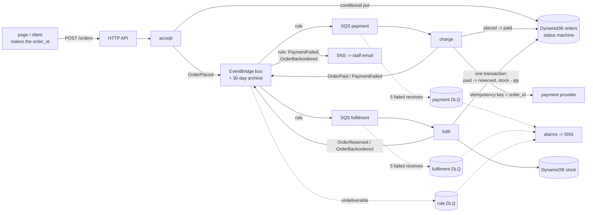
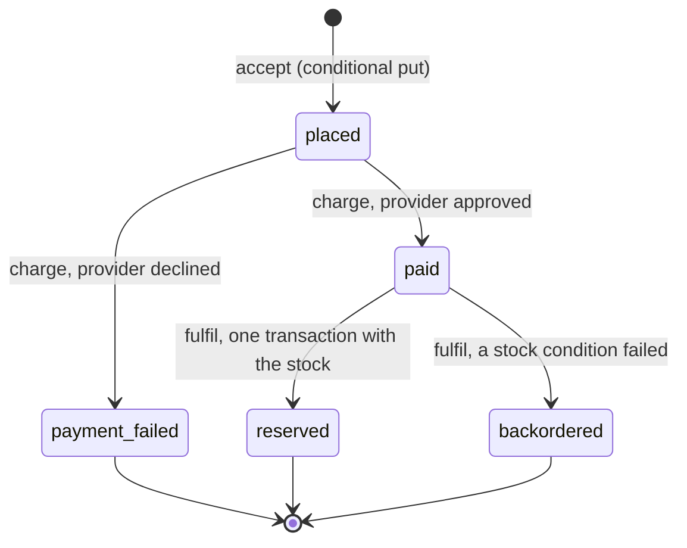
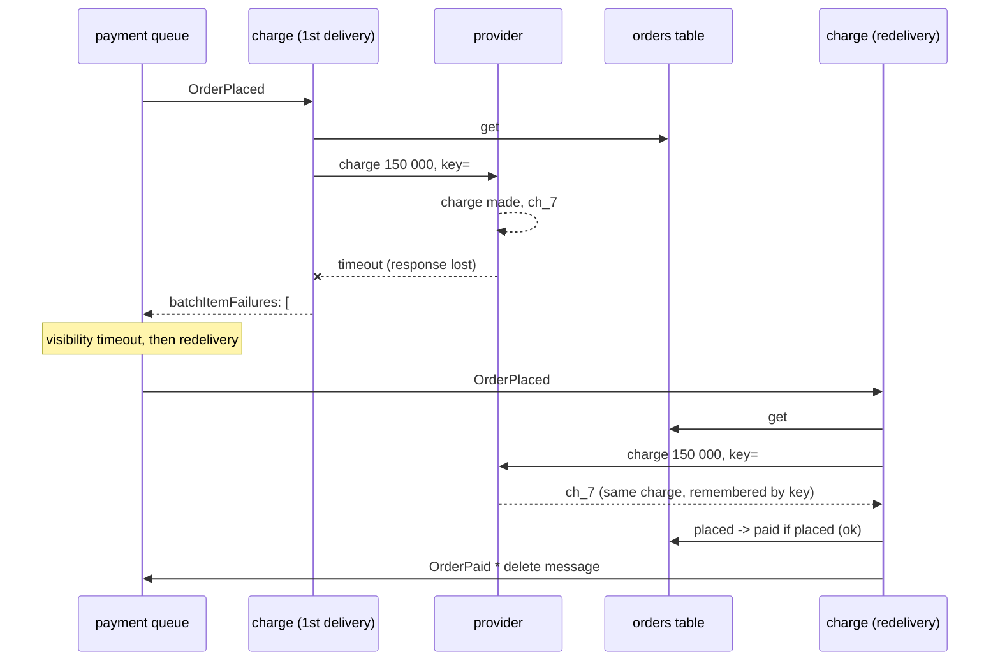

# Chapter 4 - Event-driven order processing: every message arrives at least once, so every step must be safe to repeat

*Chapters 2 and 3 moved data: a lost reading is a gap in a chart. This chapter moves money and stock: a lost message is a farm that paid and never got its feed, a doubled one is a farm charged twice. The question is no longer "did the job run" but "did this one event get lost or doubled", and the answer is not a better queue but three guards in the code.*

The code is in [`examples/ch04/`](examples/ch04/). `make check` at the repo root lints it, runs its 35 tests (106 with chapters 1 to 3), synthesises the stack, prints the cost tables in section 5 and then runs the three functions through a simulated month of bad luck, with and without their guards. Run it before reading further; the table in section 4 comes from that run.

## 1. The brief

> The cooperative that runs the monitored farms also sells to its 400 members: feed, drip line, gloves, replacement sensor nodes. Orders come from the page in chapter 1. A farm must be charged exactly once per order, whatever its phone connection does; stock must never be sold twice; an order the shelf cannot fill must reach a person the same day, because the farm has already paid. Payment goes through an external provider that times out a few times a week. Two developers, no operations team, and a warehouse system that will be replaced next year, so nothing may depend on its internals.

The constraints and what each removes:

| Constraint | What it rules out |
|---|---|
| Charged exactly once, whatever the connection does | trusting that a request arrives once: the phone retries, the queue redelivers, the function dies mid-way; "once" has to be enforced by the data, not hoped for from the network |
| Stock never sold twice | a read-then-write on the stock count from two consumers at once |
| Unfillable orders reach a person the same day | a log line; the failure has to become a message to someone |
| A provider that times out | a synchronous charge inside the HTTP request: the page would hang, and a timeout after the charge leaves nobody knowing whether money moved |
| Two developers | a workflow engine to host, a broker to patch, a service that must be up for orders to be accepted |
| The warehouse system changes next year | calling it from the order code; it must be a consumer that can be swapped without touching the producer |

The last two rows push the same way: the thing that accepts an order stores it, announces it, and returns, knowing nothing about what happens next. Everything after that is a consumer of an announcement, and a consumer can be added, replaced or paused on its own. That is event-driven, and its price is the subject of this chapter: once announcements travel through queues, every one of them can arrive twice.

## 2. Reference architecture



One API route, one bus, two queues, three functions, two tables. The client generates the order id before its first attempt and sends it with every retry; the accept function stores the order under that id, on condition that it is new, and publishes `OrderPlaced`. Rules copy each event to the queue of the consumer that wants it, and the two events that need a person go to an SNS topic. Each consumer is a Lambda function fed by its queue in batches of ten.

Walk one order through. The farm's phone posts, the reply is lost in a tunnel, the phone posts again: the second put fails its condition, and the function returns the stored order and announces it again. Two `OrderPlaced` events reach the payment queue, which may itself hand either out twice. The first delivery finds the order `placed`, charges the provider with the order id as the idempotency key, moves the status to `paid` on condition that it was `placed`, and publishes `OrderPaid`; every later delivery finds the status moved and only announces it again. The fulfil function moves `paid` to `reserved` and takes the quantities off the stock items in one transaction; a duplicate fails the first condition and takes nothing; an order the shelf cannot fill fails a stock condition and becomes `backordered`, with a staff email. A message that fails five times, whatever the reason, lands in a dead-letter queue whose alarm tells the same people.

## 3. Service choices and their alternatives

Chapter 3's rule was *notice silence*. This chapter's rule: **every delivery is at-least-once, so every step must be safe to repeat; then a duplicate costs nothing, and the only enemy left is a message that is lost, which a dead-letter queue and an archive make recoverable.**

| Layer | Chosen | Also reasonable | Rejected for this brief, and why |
|---|---|---|---|
| Announcing | an EventBridge bus with one rule per consumer, delivering into that consumer's own SQS queue | SNS topic fanning out to queues (cheaper per message, no content filtering, no archive); Kinesis when consumers must replay in order at high volume | the accept function calling the charge function directly: a dead consumer fails the order, and the warehouse swap next year touches the producer |
| Buffering | SQS standard, one queue per consumer, dead-letter queue, five receives | SQS FIFO with the order id as message group, if steps for one order had to arrive in order (section 5 prices it: about 6 % more) | no queue, a rule invoking Lambda directly: EventBridge retries for 24 hours, but there is no backlog to inspect, no batching, no per-message retry count |
| Running a step | Lambda, batch of ten, partial batch responses | Fargate when a step holds a connection pool or takes minutes | a server polling the queue: something to keep up for orders to flow |
| Remembering what was done | the order item itself: a forward-only `status` moved by conditional updates | a separate table of processed message ids with a TTL, when a step has no natural state to move | nothing, "it is fine most of the time": section 4 counts how often it is not |
| The charge | the provider's idempotency key, set to the order id | a two-phase authorise-then-capture, when the shelf check should come before money moves | charging in the HTTP request: a timeout after the charge leaves money moved and nothing recorded |
| Taking stock | one `TransactWriteItems`: status move plus one conditional decrement per SKU | a stock service with its own idempotency, when stock lives elsewhere | read the count, subtract, write: two consumers do it at once and both succeed |
| When nothing works | DLQ per queue plus a DLQ per rule target, each with an alarm; a 30-day archive to replay from | Lambda destinations for a function's own failures | retrying forever: a poison message holds its batch, then its queue |
| Orchestration | none: each consumer reacts to one event and publishes one | Step Functions Express when a single owner must see the whole flow and it fits in five minutes | Step Functions Standard per order: fifty times the messaging cost at scale (section 5), for a flow with three steps |

Two rows need a sentence. The *remembering* row is the design: a step that moves a status with a condition has its idempotency record for free, and the record can never disagree with the data because it *is* the data. A separate "processed messages" table is right for a step with nothing to move, such as sending an email, and wrong here, where it would have to be kept in step with the order in a transaction anyway. The *announcing* row picks EventBridge over SNS for two things the brief needs: a rule for the new warehouse system can be added without the producer knowing, and the archive makes "replay yesterday's `OrderPaid` events into the fixed consumer" one command.

The two real systems from the earlier chapters have no queue, and it is worth seeing why they need none. The [smart-poultry-farm](https://github.com/Mariam-zeqred/smart-poultry-farm) README says the app controls the device through a small `control` node in Firebase Realtime Database that the controller follows over a server-sent-events stream, while "rarely changing settings are polled"; the [queen-bee-incubator](https://github.com/Mariam-zeqred/queen-bee-incubator) apps set the target temperature and push OTA and resume commands through Firebase nodes in the same way. That is desired *state*, not a stream of commands: a toggle written twice is the same toggle, and a controller that reconnects reads the node once and is current. State is idempotent by construction. An order is "do this once", not "be like this", and that is where the guards begin.

## 4. Worked example: three guards and a month of bad luck

The stack is [`examples/ch04/stack.py`](examples/ch04/stack.py), about 260 lines of CDK that synthesise to 43 resources. The functions are three files in [`examples/ch04/lambda/`](examples/ch04/lambda/) plus a shared module, about 550 lines with the stub provider and the boto3 adapters, all run against fakes by the tests and the simulator.

**Guard one: the client names the order.** [`accept.py`](examples/ch04/lambda/accept.py) requires a UUID the client generated before its first attempt, and writes with a condition:

```python
table.put_item(Item=order, ConditionExpression="attribute_not_exists(order_id)")
```

A retry fails the condition; the function reads what is stored and returns it, a 200 instead of a 201. If the stored order is still `placed` it also publishes `OrderPlaced` again, because the first attempt may have died between the put and the publish. That is the one gap in "write, then announce", and the cure is to announce again whenever the status says the announcement might not have happened. The simulator counts the cost: 627 `OrderPaid` events for 480 paid orders, every extra one absorbed by a conditional update downstream.

**Guard two: the status only moves forward, conditionally.** [`orders_common.py`](examples/ch04/lambda/orders_common.py) holds the transitions and one function that makes them:

```python
NEXT = {"placed": {"paid", "payment_failed"}, "paid": {"reserved", "backordered"}, ...}

table.update_item(
    Key={"order_id": order_id},
    UpdateExpression="SET #s = :to, #f0 = :f0",      # the charge id travels in the same write
    ConditionExpression="#s = :from",
    ...
)
```



Two deliveries of the same `OrderPlaced` both call the provider with the same key and get the same charge back; both try `placed -> paid`; exactly one succeeds and publishes. The function never needs to know whether it is the first delivery, the second, or the retry of a crashed batch: it reads the status and acts on it.

**Guard three: the provider's idempotency key, and what a lost response looks like.**



Without the key, the redelivery is a second charge. [`charge.py`](examples/ch04/lambda/charge.py) ships a stub provider that remembers keys inside one container; a real provider keeps them server-side, which is what makes the retry safe across containers.

**The transaction.** [`fulfil.py`](examples/ch04/lambda/fulfil.py) builds one `TransactWriteItems` with the status move first and one conditional decrement per SKU:

```python
{"Update": {"TableName": orders, "Key": {"order_id": id},
            "UpdateExpression": "SET #s = :to", "ConditionExpression": "#s = :from"}},
{"Update": {"TableName": stock, "Key": {"sku": sku},
            "UpdateExpression": "SET available = available - :q",
            "ConditionExpression": "available >= :q"}},
```

DynamoDB reports which item cancelled the transaction: item 0 means a duplicate, nothing to do; any other means the shelf is short of that SKU, and the order moves to `backordered` with the short list, which the staff email carries. A transactional item costs two write units instead of one, the largest line at scale in section 5 and the price of "never sold twice".

**Partial batch responses.** Each consumer returns the ids of the records it could not process, and Lambda deletes the rest:

```python
return {"batchItemFailures": [{"itemIdentifier": i} for i in failed_ids]}
```

The event source mapping has `ReportBatchItemFailures` on, which the stack test checks. Without it, one record that is not JSON would redeliver the nine good ones beside it five times and then dead-letter all ten. A crash still fails the whole batch, as in the real runtime, which is why the redrive policy allows five receives and not three: at three, the simulator dead-lettered an innocent message in one seed of five; at five, in none of eight.

**The month of bad luck.** [`sim.py`](examples/ch04/sim.py) runs the three functions against fakes of everything that goes wrong: a client that never sees its reply one time in ten, a queue that hands a message out twice one time in twenty, a provider that charges and then times out one time in twenty, a runtime that dies right after a table write three times in a hundred, and three messages nobody can parse. The same 500 orders go through the functions as written and through naive versions with the guards removed (server-made id, no key, unconditional writes). The probabilities are parameters at the top of the file and describe no real shop; the table is `make ch04-sim`:

| What happened | guarded (this chapter) | naive (guards removed) |
|---|---:|---:|
| orders intended | 500 | 500 |
| POST requests | 554 | 554 |
| orders stored | 500 | 554 |
| provider charges | 500 | 706 |
| orders charged twice or more | 0 | 128 |
| cents charged vs intended (approved orders) | 165 937 000 / 165 937 000 | 238 262 000 / 165 937 000 |
| final statuses | reserved 476, payment_failed 20, backordered 4 | reserved 531, payment_failed 23 |
| shelf taken vs reserved, SHT31-NODE | 2 397 / 2 397 | 3 385 / 2 726 |
| oversold SKUs | none | SHT31-NODE |
| staff notices (unique orders) | 30 (24) | 0 |
| payment DLQ | 3 | 4 |

Read the columns against the brief. Guarded: 500 orders for 554 requests, each charged exactly once, the money charged equal to the money intended to the cent, the stock that left the shelf equal to the stock reserved, 24 orders needing a person and 24 people told (30 emails: six duplicates, the cost of announcing again, and exercise 4's subject), and a dead-letter queue holding exactly the three poison messages. Naive: 54 phantom orders, 128 farms charged two or more times, 44 % more money taken than intended, a SKU with a negative count, nobody told about anything, and four messages in the dead-letter queue, one a copy of a real order's event that a redrive would charge again. The naive column is not a strawman: each defect is one missing line, a condition expression, a keyword argument, a transaction instead of two writes.

## 5. What it costs

The tables are printed by [`examples/ch04/cost.py`](examples/ch04/cost.py) from `prices.json` (AWS Price List API, SQS and EventBridge copied 2026-10-22, the rest reused from earlier chapters) and the assumptions in that file: two lines per order, 2 % client retries, 1 % duplicate deliveries, 5 % of orders needing a person, orders kept a year with point-in-time recovery, and Lambda keeping five 20-second long polls open per queue all month. That last one is the documented minimum for standard queues, assumed rather than measured, and it is the number that matters at the small end.

| Line item | 2 000 orders | 100 000 orders | 10 000 000 orders |
|---|---:|---:|---:|
| API Gateway (HTTP API) | $0.00 | $0.10 | $10.20 |
| Lambda (accept + charge + fulfil) | $0.00 | $0.19 | $17.61 |
| EventBridge events + 30-day archive | $0.01 | $0.32 | $32.22 |
| SQS requests (incl. empty receives) | $0.12 | $0.24 | $8.93 |
| DynamoDB orders + stock (writes, reads, storage, PITR) | $0.02 | $0.90 | $90.16 |
| SNS emails to staff | $0.00 | $0.08 | $9.98 |
| 5 alarms + logs | $0.50 | $0.52 | $2.62 |
| **Total / month** | **$0.65** | **$2.36** | **$171.72** |
| per order | $0.00033 | $0.00002 | $0.00002 |

Three things to take from it. At the cooperative's size the bill is 65 cents, and 62 of them are for listening: five alarms and 1.3 million empty receives from pollers waiting on two queues that see 4 000 messages a month. The per-order cost falls fourteenfold between 2 000 and 100 000 orders and then stops falling at about two thousandths of a cent, where the largest line is DynamoDB: the transaction's double write units and a year of storage. The messaging itself is never the problem; what it would cost through other plumbing is the second table:

| Messaging line only | 2 000 orders | 100 000 orders | 10 000 000 orders |
|---|---:|---:|---:|
| EventBridge + SQS standard (this chapter) | $0.13 | $0.54 | $39.33 |
| EventBridge + SQS FIFO (ordered per order id) | $0.16 | $0.60 | $41.56 |
| Step Functions Standard, one execution per order | $0.40 | $20.00 | $2,000.00 |
| Step Functions Express, one execution per order | $0.00 | $0.20 | $20.42 |

FIFO costs 6 % more for in-order delivery per order id, which this design does not need because every step checks the status. A Standard workflow per order is priced per state transition, eight here, and at ten million orders that is two thousand dollars for a three-step flow; Express is priced like Lambda and is cheaper than the bus and queues. Events are therefore not chosen on cost. They are chosen because the warehouse consumer can be replaced next year without the accept or charge functions changing, and because a consumer down for an hour leaves a backlog in its queue rather than a failed execution per order.

## 6. How it fails

| Failure | What you see | What already limits it | What you would add next |
|---|---|---|---|
| The phone retries a POST | two requests, one order | the client-made id and the conditional put | nothing; this is the design |
| The accept function dies between the put and the publish | an order `placed` that nobody charges | the next retry of the same POST announces it again | a scan for orders `placed` for more than an hour, announcing them (exercise 1); or DynamoDB Streams as the publisher (exercise 5) |
| The provider charges, then the response is lost | a message retried; a second provider call | the idempotency key returns the first charge | an alarm on the provider's own timeout count, to catch a provider that is degrading |
| The provider is down for an hour | every message in the payment queue fails and comes back; the oldest grows older | the `PaymentStuck` alarm at 15 minutes; messages wait, nothing is lost or doubled | pause the event source mapping and let the backlog drain when the provider is back, instead of burning five receives per message into the DLQ (exercise 2) |
| Two deliveries race each other | both charge with the same key, both try `placed -> paid` | the condition: one publishes, the other sees a conflict | nothing |
| The shelf is short | the transaction cancels on the stock item | the order moves to `backordered`, the staff email names the SKU | a reservation that expires, so a backordered order holds nothing and a cancelled one gives back what it took |
| A message nobody can parse | five receives, then the DLQ; alarm | partial batch responses keep the nine others out of it | a runbook: read it, fix the producer, delete or redrive |
| A consumer has a bug and processed a day of orders wrongly | the data is wrong, the queues are empty | the bus archive holds every event for 30 days | fix the consumer, reset the affected orders' statuses, replay the day from the archive into the one rule |
| EventBridge cannot deliver to a queue (its policy was changed) | events in the rule DLQ; alarm | 24 hours of retries first | nothing; this is what the rule DLQ is for |
| The accept function's role loses `PutEvents` | orders stored, none announced, 500s to the client | the client retries; nothing is lost | the "placed too long" scan from row 2 |
| The whole region is unavailable | no orders accepted | nothing in this chapter | chapter 5 |

Again the third column: a condition expression, a keyword argument, a transaction and an alarm per queue turn every doubling into a no-op and every loss into a backlog someone is told about.

## 7. Exercises

1. **The order nobody charged.** Row 2 of section 6 is covered only if the client retries. Design the scan: a scheduled function that finds orders `placed` for more than an hour and announces them again. What does it need on the table, what does it cost at 10 000 000 orders a month, and why is announcing again safe?
2. **The provider is down.** With a 30-second function timeout and a 180-second visibility timeout, how long after the provider goes down does the first message reach the dead-letter queue? How many provider calls does a backlog of 1 000 orders make before the alarm fires, and what single setting on the queue or the mapping changes that most?
3. **FIFO or not.** The warehouse's new system requires one farm's `OrderPaid` events in the order the farm placed them. Which queue type, what message group id, what deduplication id, and which of the three guards becomes unnecessary, if any?
4. **Thirty emails for twenty-four orders.** The staff topic received six duplicate notices in the simulation. Propose two ways to send exactly one email per order and say what each costs in code and in money; one of them should not touch the consumers.
5. **The outbox for free.** Replace "write, then publish" in all three functions with DynamoDB Streams on the orders table feeding an EventBridge Pipe that publishes an event per status change. Which guard does that remove, which does it keep, what new duplicate does it introduce, and what happens to the simulator's `events published` row?

<details>
<summary>Answers</summary>

**1.** The orders table is keyed by id, so "placed for more than an hour" needs either a sparse GSI (an attribute set at placement and removed when the status moves on, so only `placed` orders are in the index) or a scan with a filter over the whole table. At 10 000 000 orders a month the table holds about 120 million items; an hourly scan of 700-byte items is about 10 million eventually-consistent read units each time, around $900 a month. The GSI costs one index write and one delete per order, about $13. Announcing again is safe because the charge function treats a repeated `OrderPlaced` as a duplicate unless the status really is `placed`, in which case the charge has not happened and should. It is chapter 3's `NoSuccessTodayAlarm` again: silence noticed by a clock, not by an error.

**2.** Each failed receive puts the message back after the 180-second visibility timeout, so five receives take four waits: 4 × 180 s = 12 minutes plus five invocations, so the first message dead-letters about 12.5 minutes after the outage starts, just before the 15-minute `PaymentStuck` alarm. Every receive of every message calls the provider once (the call is what times out), so a backlog of 1 000 orders makes up to 5 000 calls before they are all dead-lettered, against a provider that is already struggling. The setting is the mapping, not the queue: disabling the event source mapping (or setting `maximum_concurrency` to a small number) stops the polling; the messages wait in the queue for up to four days with no receives counted, and re-enabling the mapping drains the backlog. The DLQ is for messages that cannot be processed, not for a dependency that is down.

**3.** An SQS FIFO queue with the farm id as the message group id: messages in one group are delivered in order and one batch at a time, while different farms proceed in parallel. The deduplication id is the event id EventBridge assigned (or the order id plus the status, since one order announces each status once), and FIFO's five-minute deduplication window drops an exact repeat sent within it. None of the three guards becomes unnecessary. FIFO deduplicates *sends* within five minutes; a client retry an hour later, a provider response lost, a function that died after the write and before the delete all still happen, and the status conditions and the idempotency key are still what stops them. FIFO buys ordering, at 6 % more per request and a throughput limit per message group, not idempotency.

**4.** (a) A `notified` attribute on the order, set with `attribute_not_exists(notified)` by the consumer before it publishes the staff event; the second announcement finds it and stays quiet. One write unit per notice and a few lines in two functions. (b) Without touching the consumers: route the two events to an SQS FIFO queue with the order id as deduplication id and forward from it to SNS with a small function or an EventBridge Pipe. FIFO drops a repeat within its five-minute window, which covers a redelivery but not a retry an hour later. A queue, a function, a fraction of a cent per thousand notices. For twenty-four emails a month, (a) is the honest answer; (b) is for consumers that are someone else's code.

**5.** With a stream on the orders table every status change becomes an event whether or not the function survived the write, so the "write, then announce" gap closes and the announce-again code in all three functions can go: the stream is the outbox, kept in step with the data by the database. It keeps the conditional put, the conditional status moves and the idempotency key, because the stream is at-least-once too and a Pipe can deliver one change record twice. It adds a second or so of latency between write and event. The simulator's `events published` row would drop to one event per status change (500, 480 and 480) plus the Pipe's own redeliveries, instead of 627 `OrderPaid` for 480 paid orders. The stack grows a stream, a Pipe and a role; the functions shrink.

</details>

## What to read next

- **Amazon SQS Developer Guide, "At-least-once delivery"** and **"Using dead-letter queues"**: why a standard queue delivers twice, what `maxReceiveCount` counts.
- **AWS Lambda Developer Guide, "Using Lambda with Amazon SQS"**, *Implementing partial batch responses* and *Configuring scaling behavior*: where `ReportBatchItemFailures`, the five pollers and the "at least five" recommendation come from.
- **Amazon DynamoDB Developer Guide, "Condition expressions"** and **"Managing complex workflows with DynamoDB transactions"**: the two primitives every guard here is built on.
- **Amazon EventBridge User Guide, "Archiving and replaying events"** and **"Event retry policy and using dead-letter queues"**: the recovery tools of section 6.
- **Stripe API reference, "Idempotent requests"**: how a real provider implements the key the stub in `charge.py` imitates.
- **Pat Helland, "Idempotence Is Not a Medical Condition" (ACM Queue, 2012)**: this chapter's argument, made before most of these services existed.
- **Chapter 5, multi-region, backups, RPO and RTO**, where the question is what survives the last row of section 6.
