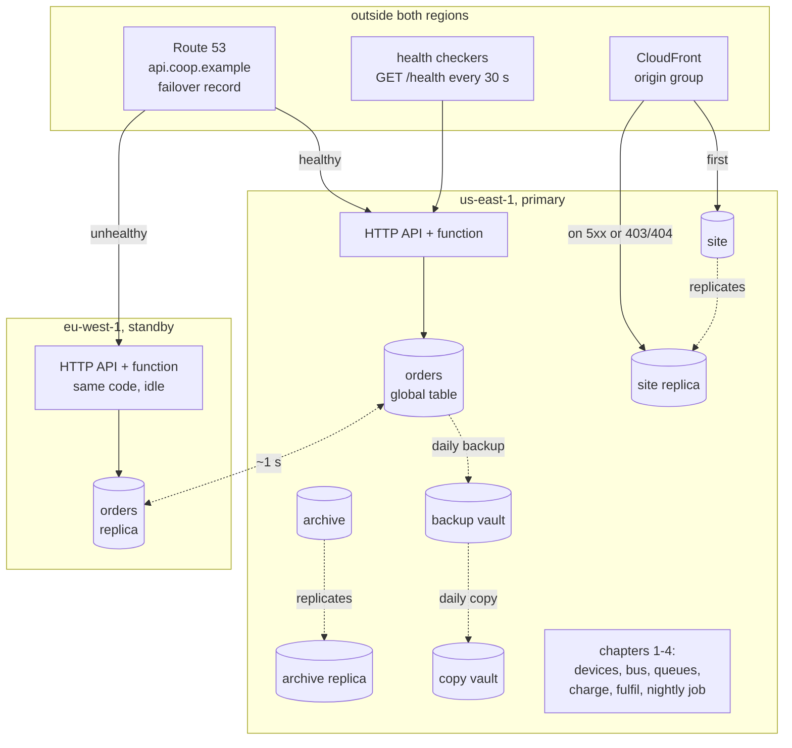

# Chapter 5 - Multi-region, backups, RPO and RTO: decide what you may lose before deciding what to copy

*Chapter 4's failure table ended with one row that nothing in the stack answered: the whole region is unavailable. This chapter answers it, but not first. The first question is which of the cooperative's data may be lost, and for how long each may be unavailable, because the answers differ by data set and so do the copies they justify. Then two things usually confused get separated: a replica protects you from the region; a backup protects you from yourself.*

The code is in [`examples/ch05/`](examples/ch05/). `make check` at the repo root lints it, runs its 38 tests (144 with chapters 1 to 4), synthesises both regions' stacks, prints the cost tables in section 5 and then runs two drills: four disasters against four recovery strategies, and a stock counter decremented from two regions at once. Run it before reading further; the tables in section 4 come from that run.

## 1. The brief

> The cooperative's board has read about a cloud region being down for most of a day and asks two questions: what happens to us, and what happens if one of our two developers deletes something by mistake? Pressed for answers: a farm that paid must never lose its order; the shop may be closed for a few hours, not a day; the farm page must keep showing the last known state of every house; a day of lost telemetry history is acceptable, a week is not; a mistake must be undoable to the minute, the same day; the controllers in the houses must not depend on any of this. Budget: a few dollars a month at today's size; no operations team.

The constraints and what each decides:

| Constraint | What it decides |
|---|---|
| A paid order is never lost | the orders table's copy must be continuous, not nightly: a recovery point objective of seconds, which only replication gives |
| The shop may close for hours, not a day | a recovery time objective of a few hours for ordering; a standby that takes DNS by itself is nice, a person finishing the job within the hour is enough |
| The page keeps showing last known state | the site and its data must be readable from a second region without anyone doing anything: automatic failover for reads |
| A day of telemetry may be lost, a week may not | the archive needs a copy that is at most a day behind, and nothing faster |
| Mistakes undoable to the minute | point-in-time recovery, which no replica provides, because a replica copies the mistake |
| Controllers must not depend on the cloud | nothing to build: section 3 checks the two real controllers against this |
| A few dollars a month | no second copy of anything that runs while idle; serverless makes a standby almost free, and section 5 says exactly how free |

The table is the design method. Every row names a data set, a number of seconds or hours of data it may lose (the recovery point objective, RPO) and a number of minutes or hours it may be unavailable (the recovery time objective, RTO). Everything else in the chapter is the cheapest copy that meets each pair of numbers.

## 2. Reference architecture



One class of stack, deployed twice. The primary holds everything chapters 1 to 4 built plus three copies going out: the orders table is a DynamoDB global table with a replica in Ireland, the archive and site buckets replicate object by object, and a daily backup of the table is copied into a vault in the other region. The standby holds the destinations and the same API, deployed and idle. Outside both regions sit Route 53, whose health checkers call the primary's `/health` from several places in the world and answer `api.coop.example` with whichever region is healthy, and CloudFront, which already serves the page from the edge and now has a second bucket to read from.

Walk the outage. The primary's API stops answering. Ninety seconds later three checks in a row have failed and Route 53 switches the record; within another sixty seconds every resolver that honours the TTL sends `api.coop.example` to Ireland, where the same function reads the same orders from the replica and accepts new ones into it. The page never stopped: CloudFront got nothing from its first origin and read `index.html` from the replica bucket. What did stop is money moving: chapter 4's charge and fulfil consumers live in the primary only, and orders accepted in Ireland wait as `placed` until a person starts the consumers there. Section 4 shows why that is a person's decision.

## 3. Service choices and their alternatives

Chapter 4's rule was *every step must be safe to repeat*. This chapter's rule: **decide what you may lose before you decide what to copy: one RPO and one RTO per data set, then the cheapest copy that meets them; and a copy made by replication is a copy of your mistakes too, so it never replaces a backup.**

First the data sets, because the brief had six of them and they are not alike:

| Data set | Owner chapter | RPO | RTO | Copy that meets it | Why not more |
|---|---|---|---|---|---|
| orders and their status | 4 | seconds | hours (shop), minutes (reading them) | global table replica; PITR and daily copies for the undo | a copy once a day loses a day of paid orders |
| stock counts | 4 | seconds | hours | the same table; written from one region at a time | section 4: a counter cannot be written from two regions |
| device status, 30-day history | 2 | the devices resend; a minute | minutes to read | nothing new: the page shows the replica's last known state; devices publish to one region (exercise 1) | the data re-creates itself from the fleet |
| telemetry archive | 2 | a day | a day | S3 replication to the standby bucket, versioned, no delete replication | AWS Backup for S3 costs twice the storage for the same copy |
| models and predictions | 3 | a day | a day | nothing: the nightly job rebuilds them from the archive | they are derived data |
| the site | 1 | minutes | seconds | replicated bucket behind a CloudFront origin group | a static site is the cheapest thing in the system to copy |
| the controllers | the two real repos | none | none | nothing: they do not depend on the cloud | see below |

Then the mechanisms:

| Layer | Chosen | Also reasonable | Rejected for this brief, and why |
|---|---|---|---|
| Copying the orders table | DynamoDB global table, one replica, PITR on both sides | AWS Backup copies alone, when seconds of RPO are not needed (section 5: a quarter of the price); DynamoDB export to S3 when the copy is for analysts, not for failover | a scheduled scan-and-write of your own: slower, costlier, and yours to debug at 3 a.m. |
| The undo | PITR (35 days, any second) plus a daily AWS Backup recovery point copied to the other region | on-demand backups before each deploy, in addition | relying on the replica: an item deleted here is deleted there within a second |
| Copying the archive | S3 replication, versioned buckets, delete markers not replicated, lifecycle on old versions | S3 Replication Time Control when the copy must be 15 minutes behind at most (1.5 cents a GB more) | AWS Backup for S3 ($0.05 a GB-month against $0.023 for the replica, for a slower copy) |
| Sending clients to the healthy region | Route 53 failover record with a health check on the whole path | latency-based records when both regions serve reads; Global Accelerator when clients cannot be trusted to re-resolve DNS | a list of two hostnames in the client: the app that needs it most is the one that cannot be updated during the outage |
| Serving the page | CloudFront origin group, replica bucket as fallback | a second distribution and a failover record | nothing: the page is where the farm reads "last known state" |
| The standby's size | the API deployed and idle in the other region ("pilot light" and "warm standby" are the same thing when nothing runs while idle) | nothing deployed, redeploy from code on the day (backup & restore): cheaper by the standby's alarms, slower by half an hour | active-active: section 4 |
| Who writes | one region at a time; the chapter 4 consumers move with a person's decision | a home region per farm, so each farm's orders and stock are written in one place | both regions writing the same items: last writer wins, and a counter loses writes |
| Noticing | alarms on health, replication lag, replication backlog, a day without a backup, failed backup and copy jobs | AWS Backup's own restore-testing plans, which restore a recovery point on a schedule and report | trusting the console's green ticks |

Three rows deserve a sentence. The *undo* row is the chapter's second half: a replica copies deletions and bad writes as faithfully as good ones, so what saves you from a script that empties the table is point-in-time recovery, and what saves you from credentials that delete the table and its PITR together is a recovery point in a vault those credentials cannot reach. The *standby's size* row is where serverless changes the textbook: the usual ladder from backup-and-restore to pilot light to warm standby to active-active is a ladder of idle cost, and here the API, the function and the replica cost nothing idle, so the middle rungs collapse into one. The *who writes* row is why active-active is rejected at the same price: section 4 shows a condition that holds in each region and fails across them.

The controllers get their own paragraph, because the brief's last constraint is already met. The [smart-poultry-farm](https://github.com/Mariam-zeqred/smart-poultry-farm) README states that the controller "keeps working with no internet at all": a 16x2 LCD and four buttons give full local control, "automatic climate control runs on the device, and control ownership hands itself back to the LCD whenever the cloud is unreachable", and the scheduled fan cycle "keeps running through a network outage". The [queen-bee-incubator](https://github.com/Mariam-zeqred/queen-bee-incubator) README describes an ESP32 that holds the chamber at 34.5 °C with hysteresis control, "enforces a hardware-independent safety layer" and "logs every reading to an SD card and to Firebase". In both, the cloud is for watching and tuning and the control loop is on the board, so the device tier has an RTO of zero because it was never in the loop; what the cloud must keep alive is monitoring and sales. Whether a controller could backfill the hours it logged locally is exercise 1; neither README says it does.

## 4. Worked example: two stacks, two drills

The stack is [`examples/ch05/stack.py`](examples/ch05/stack.py), one class instantiated twice by [`app.py`](examples/ch05/app.py): 42 resources in the primary, 23 in the standby. The function is [`lambda/api.py`](examples/ch05/lambda/api.py), about 110 lines, the same file in both regions. The drills are [`drill.py`](examples/ch05/drill.py).

**The table is created once and exists twice.** The primary declares the replica; the standby only knows the name:

```python
orders = dynamodb.TableV2(self, "Orders", table_name=TABLE_NAME, ...,
    point_in_time_recovery_specification=PointInTimeRecoverySpecification(point_in_time_recovery_enabled=True),
    deletion_protection=protect_data,
    replicas=[dynamodb.ReplicaTableProps(region=STANDBY_REGION,
        point_in_time_recovery_specification=..., deletion_protection=protect_data)])
```

The standby's `TableV2.from_table_name(self, "Orders", TABLE_NAME)` resolves to the replica's ARN in its own region, which the test checks, so the standby function reads and writes Ireland's copy. Deletion protection is on both replicas and the removal policy is retain: a wrong `cdk destroy` leaves the data where it is.

**Buckets replicate, deletes do not.** Each bucket in the primary carries one rule, and both regions' buckets are versioned, which replication requires and which is also the undo button for an overwritten object:

```python
s3.ReplicationRule(destination=standby_bucket, id=f"{kind}-to-{STANDBY_REGION}",
                   delete_marker_replication=False,
                   metrics=s3.ReplicationTimeValue.FIFTEEN_MINUTES)
```

The destination is addressed by a deterministic name, `coop-archive-<account>-eu-west-1`, because a stack cannot reference a resource in another region without machinery that is not worth two buckets. One wrinkle surfaced in synthesis: the CDK construct names every replication role `CDKReplicationRole`, so two replicated buckets in one stack would collide at deploy; the stack removes the fixed name, and a test keeps it that way.

**The backup is the thing replication cannot be.** A daily plan at 03:00 UTC, kept 35 days to match the PITR window, copied into the standby's vault:

```python
backup.BackupPlanRule(schedule_expression=events.Schedule.cron(hour="3", minute="0"),
    delete_after=BACKUP_RETENTION,
    copy_actions=[backup.BackupPlanCopyActionProps(
        destination_backup_vault=standby_vault, delete_after=BACKUP_RETENTION)])
```

Two alarms watch it: a rule on failed, aborted or expired backup and copy jobs, and chapter 3's silence detector, an alarm that breaches when `NumberOfBackupJobsCompleted` is below one over a day, missing data counted as breaching. A backup that quietly stopped running is the most common backup.

**One hostname, two answers.** The health check asks the primary's own hostname for `/health` every 30 seconds from several AWS regions, and the handler answers only after reading one item from the table, so the check covers the path a client would take, not just the load balancer's pulse:

```python
route53.HealthCheck(self, "ApiHealth", type=HealthCheckType.HTTPS,
    fqdn=f"{api.api_id}.execute-api.{region}.amazonaws.com", resource_path="/health",
    request_interval=HEALTH_INTERVAL, failure_threshold=HEALTH_FAILURES)
route53.CfnRecordSet(self, "ApiRecord", name=api_host, type="A",
    alias_target=AliasTargetProperty(dns_name=domain.regional_domain_name,
        hosted_zone_id=domain.regional_hosted_zone_id, evaluate_target_health=True),
    failover="PRIMARY" if primary else "SECONDARY", set_identifier=f"{role}-{region}",
    health_check_id=health_check.health_check_id if health_check else None)
```

Both stacks write the same record name with different set identifiers; the standby's has no health check, because when the primary is unhealthy Route 53 answers with the secondary whatever its state, and when both are unhealthy it answers with the primary anyway. An alias record has no TTL of its own; it carries the target's, 60 seconds for API Gateway, which is where the drill's "90 s + 60 s" comes from. The record is an L1 construct because the L2 alias target cannot set `EvaluateTargetHealth`, which failover aliases require; and each region needs its own certificate, domain name and mapping for the hostname to be served at all.

**The page.** CloudFront gets an origin group: the primary's bucket first, the replica on any 5xx or on 403 and 404, which is what S3 returns for an object it cannot find or will not serve:

```python
origins.OriginGroup(primary_origin=S3BucketOrigin.with_origin_access_control(site),
                    fallback_origin=S3BucketOrigin.with_origin_access_control(fallback_site),
                    fallback_status_codes=[500, 502, 503, 504, 403, 404])
```

The replica bucket's policy admits any distribution of this account, because the distribution does not exist when the standby deploys first.

**Drill one: four disasters, four strategies.** [`drill.py`](examples/ch05/drill.py) is arithmetic over named parameters, not a simulation of AWS: a six-hour outage, a second of replication lag, a 90-second health check plus a 60-second TTL, a person who notices in 15 minutes and decides in 15 more, 25 minutes to deploy a region from code, a restore of 20 minutes plus 5 per gigabyte (assumed; see TODO), backups every 24 hours. The table is `make ch05-drill`:

| Disaster | one region | backup & restore | warm standby | active-active |
|---|---|---|---|---|
| region unavailable (6 h) | lost: none, if the region comes back; down: 6 h | lost: up to 24 h (the last copy); down: 70 min | lost: ~1 s of replication lag; down: 2.5 min to read and accept; 30 min until charged | lost: ~1 s of replication lag; down: 2.5 min for the clients that were on the dead region |
| script deletes every order | lost: none (PITR); down: 50 min | lost: none (PITR); down: 50 min | lost: none (PITR); down: 50 min | lost: none (PITR); down: 50 min |
| bad deploy corrupts statuses (5 h) | lost: none lost; wrong for 5 h; down: none | lost: none lost; wrong for 5 h; down: none | lost: none lost; wrong for 5 h; down: none | lost: none lost; wrong for 5 h; down: none |
| primary credentials leaked, everything there deleted | lost: everything; down: until rebuilt by hand | lost: up to 24 h; down: 70 min | lost: ~1 s, or up to 24 h; down: 2.5 min, or 45 min | lost: ~1 s, or up to 24 h; down: 2.5 min, or 45 min |

Read it by column and then by row. *One region* is chapters 1 to 4 as they stand: an outage is the outage, and a leaked credential with enough rights is the end, because PITR dies with the table. *Backup & restore* turns both into about an hour of work and up to a day of lost orders, the day being the copy cadence. *Warm standby* turns the outage into two and a half minutes for reading and accepting orders and half an hour until a person has the consumers charging again; what it cannot do is anything about the two middle rows, where the replica is as empty or as wrong as the original within a second and recovery is PITR in every column. Those rows are the chapter's second half in one line: replication is for the region, backups are for you. The last row's "or" is exercise 5.

**Drill two: why one region writes.** The *active-active* column looked as good as the warm standby's and costs the same. `drill.py conflict` builds a fake global table with two regions and last-writer-wins replication, puts ten sensor nodes on the shelf, and reserves six from each region in the same second, once with the orders in different regions and once with both in the primary:

| | active-active (one order in each region) | one write region (both orders in us-east-1) |
|---|---:|---:|
| units on the shelf | 10 | 10 |
| units reserved | 12 | 6 |
| `available` after replication settles | 4 in both regions | 4 in both regions |
| reservations the counter lost | 6 | 0 |
| units promised beyond the shelf | 2 | 0 |
| orders backordered | 0 | 1 |

Chapter 4's guard was `available >= :q` as a condition on the decrement, and inside one region it holds: the second order in the right-hand column fails the condition and is backordered. Across two regions each copy saw ten, each allowed six, each wrote four, and when the copies met, last writer wins kept four. Six reservations vanished from the counter and two units were sold that never existed. No condition can see the other region's write before it arrives, and global tables resolve the collision by timestamp, not by merging. That is why the consumers run in one region at a time: accepting orders in both regions is safe, because chapter 4's conditional put on a client-made id turns a collision into two identical items; decrementing a counter in both is not.

## 5. What it costs

The tables are printed by [`examples/ch05/cost.py`](examples/ch05/cost.py) from `prices.json` (AWS Price List API, copied 2026-10-25 for both regions; the two things the sandbox could not check are named in that file) at two sizes: the cooperative as chapters 2 and 4 sized it, and a hundred times the devices with fifty times the orders. The first table is what this chapter adds to the chapters 1 to 4 bill:

| Line item | 1 000 devices, 2 000 orders | 100 000 devices, 100 000 orders |
|---|---:|---:|
| DynamoDB replica: replicated writes, storage, PITR (eu-west-1) | $0.02 | $0.79 |
| S3 replicas: storage (eu-west-1), replication PUTs, inter-region transfer | $0.35 | $30.73 |
| AWS Backup: 35 daily copies in each region + cross-region transfer | $0.15 | $7.28 |
| Route 53: hosted zone, 1 health check, alias queries | $0.50 | $0.50 |
| Standby API + function, idle | $0.00 | $0.00 |
| 5 alarms + 8 replication metrics | $2.90 | $2.90 |
| **Added / month** | **$3.91** | **$42.21** |

At the cooperative's size the standby costs under four dollars a month, and three of them are for watching the copies: five alarms and the eight CloudWatch metrics that S3 replication publishes. The replica of a 17-megabyte orders table costs two cents; the API and function in Ireland cost nothing until the day they serve. At scale the bill is the archive again, as in chapter 2: a second copy of 1.2 terabytes is $29 of the $42, and the lever is the same, less raw history or a colder storage class for the replica.

The second table is the money beside the drill:

| Strategy, added / month | 1 000 devices, 2 000 orders | 100 000 devices, 100 000 orders |
|---|---:|---:|
| one region (chapters 1-4 as they are) | $0.00 | $0.00 |
| backup & restore (daily copies + replicated archive + a zone) | $1.00 | $38.51 |
| warm standby (this chapter) | $3.91 | $42.21 |
| active-active (same resources, both regions writing) | $3.91 | $42.21 |

Backup and restore is cheaper than the warm standby by three to four dollars at either size, and the gap is the alarms, the replication metrics and a replica of a small table, not the standby API, because nothing in it runs while idle. Those three dollars buy the difference between two and a half minutes and seventy minutes in the drill's first row, and between a second and a day of lost orders. Active-active costs exactly the same because the resources are identical; it is rejected on correctness, not on money.

## 6. How it fails

| Failure | What you see | What already limits it | What you would add next |
|---|---|---|---|
| The primary region is unavailable | `/health` fails from everywhere; `PrimaryUnhealthy` alarm; the record flips | reads and acceptance continue from Ireland in about 150 s; the page from the replica bucket | the runbook for moving the consumers, and its reverse (exercise 3) |
| The health check flaps (the primary is slow, not down) | the record flips back and forth; clients see both regions within minutes | `EvaluateTargetHealth` and a three-failure threshold; accepting orders in both regions is safe | a longer threshold, or a check interval of 10 s with a higher one, so a flap needs a longer fault |
| A resolver ignores the TTL | some clients keep reaching the dead region for longer than 60 s | nothing; DNS is advisory | the page's API client retries on connection failure; Global Accelerator if that is not enough |
| Replication lags | `ReplicationLagging` after two minutes of lag | PITR on both sides; nothing is lost, the standby is behind | a note in the runbook: do not move the write region while the alarm is on |
| An object was overwritten or deleted by mistake | the replica has the same change (overwrite) or still has the object (delete) | versioning on both sides keeps every version 90 days; delete markers are not replicated | an S3 Object Lock retention on the archive, if a regulator asks |
| A script deletes every order | the replica is empty a second later | PITR restores any second of the last 35 days into a new table | the restore drill, run on purpose once a quarter (exercise 4) |
| The backup job stops running | nothing, which is the problem | `NoBackupToday` breaches on a day without a completed job; failed jobs are routed as events | an AWS Backup restore-testing plan that restores a recovery point weekly and checks it |
| Credentials with admin rights in the primary are leaked | table, PITR and the primary vault can all go | deletion protection and a retain policy slow a mistake, not an attacker | Vault Lock on the standby vault, or a separate account for it (exercise 5) |
| The standby stack drifted (not deployed since spring) | the failover reaches an old API | one class for both regions, so a change cannot be made to one only | CI that deploys both regions from the same commit |
| The certificate in the standby cannot renew | the standby's domain stops serving at expiry | DNS validation renews on its own while the validation record exists | an alarm on ACM's `DaysToExpiry` metric |
| Failing back | the dangerous half: two regions think they own the writes | the move is a decision, in both directions | the home-region attribute on every order, so a consumer refuses items it does not own |
| A device cannot reach the primary's IoT endpoint | status stops updating; the page shows the last known state | the controllers run without the cloud; the status table says how old each reading is | exercise 1 |

Again the third column: the stack covers the region and the mistake, and leaves the attacker and the fail-back to the exercises, because both are decisions before they are resources.

## 7. Exercises

1. **Telemetry through the outage.** The devices of chapter 2 publish to one region's IoT Core endpoint. For the six-hour outage, what does the farm page show, what is in the archive afterwards, and what would a device need to carry and do so that the gap is filled when the region returns? Say what the firmware would need without claiming the two real controllers already do it.

<details>
<summary>Answers</summary>

**1.** The page shows each house's last reading with its age, because the status table's replica stopped changing when the region did. The archive has a six-hour gap for every device, and chapter 3's features for that night are built on it. To fill it a device would keep the readings it could not deliver (both controllers log locally; the incubator to an SD card, by its README) and, on reconnection, publish them with their original timestamps on a backlog topic, which chapter 2's ingest already handles with its `ts < :ts` condition. That is firmware: a queue of undelivered readings, a bounded retry, the live reading first. Neither README says the firmware does this, so it is an extension, not a description.

**2.** Three failures take up to 90 seconds after the first failed request; a resolver that cached the old answer at second 89 keeps it for 60 more: about 150 seconds worst case, the drill's figure. With the fast interval it is 30 seconds plus the TTL, about 90 seconds, for $1 a month (the optional feature on an AWS-endpoint check). A TTL of 0 would not help because an alias record carries the target's TTL, not its own, and many resolvers impose a floor anyway; the lever you own is the health check.

**3.** Confirm the primary is healthy and its replica has caught up (`ReplicationLatency` near a second, no alarm); stop the consumers in the standby; wait for its queues to drain; check that no order is half-moved (`paid` without a reservation); start the consumers in the primary; watch the first orders through. The dangerous step is the start in the primary before the stop in the standby has taken effect, because in that window both regions decrement the same stock items, which is the conflict drill exactly. The state to check is "the other region's consumers are stopped and its queues are empty", not "the other region is healthy".

**4.** Restore the newest recovery point from the standby's vault (the copy is the one that must work) into a table with a new name in the standby region, count its items, check a sample of recent orders against the live table, record the restore duration (the parameter the drill assumes), then delete the table. Cost: at 17 megabytes under a cent; at 840 megabytes about 13 cents at the Ireland restore price. The alarm is chapter 3's again: a metric the script publishes on success, breaching after 100 silent days. AWS Backup's restore-testing plans do this on a schedule; the exercise is to know what they check.

**5.** First, Vault Lock on the standby vault in compliance mode with a minimum retention: after the grace period no principal, root included, can delete recovery points early; it costs nothing beyond the storage you can no longer delete, and it does not cover a credential that changes the plan so no new points are made, which `NoBackupToday` catches. Second, a separate account for the vault, with cross-account copy and no role the primary's principals can assume beyond the copy; it costs the account's overhead and does not cover a compromise of the organisation's management account. A second region alone is neither, because IAM is global: credentials that can delete a table in Virginia can delete its replica in Ireland and the vault beside it in the same minute.

</details>

## What to read next

- **AWS whitepaper "Disaster Recovery of Workloads on AWS: Recovery in the Cloud"**: the four strategies the drill uses, with AWS's own RPO and RTO ranges for each.
- **Amazon DynamoDB Developer Guide, "Global tables: How it works"** (last writer wins) and **"Point-in-time recovery"**: the two halves of this chapter's table.
- **Amazon S3 User Guide, "Replicating objects"**, *What is and is not replicated* and *Replication metrics*: why delete markers are a choice and what the eight metrics are.
- **AWS Backup Developer Guide, "Cross-Region backup"**, **"AWS Backup Vault Lock"** and **"Restore testing"**: the copy, the lock and the drill of exercises 4 and 5.
- **Amazon Route 53 Developer Guide, "Active-passive failover"** and **"How Amazon Route 53 checks the health of your resources"**: the 30-second interval, the three failures, and what happens when both records are unhealthy.
- **Amazon CloudFront Developer Guide, "Optimizing high availability with CloudFront origin failover"**: the status codes the origin group reacts to.
- **Chapter 6, cost and security review checklist**, where the five designs are read once more against the Well-Architected pillars, this chapter's leaked-credential row among them.
