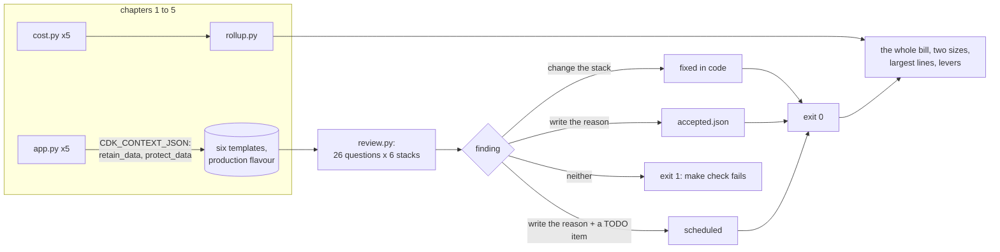

# Chapter 6 - Cost and security review checklist: ask only questions a template, a bill or a drill can answer

*Five chapters have each defended one design in the same six-part shape. This chapter turns the shape into a review: the questions a reader of CloudFormation can answer about any of the five, the questions a bill answers, and the few only a drill answers. Then it runs the review over chapters 1 to 5 as they stand, with the Well-Architected pillars as the index, fixes some things, writes down why the rest are acceptable, and leaves nothing in the third state, "noticed and ignored".*

The code is in [`examples/ch06/`](examples/ch06/). `make check` at the repo root lints it, runs its 28 tests (175 with chapters 1 to 5), synthesises every earlier chapter's stack in its production flavour, asks each template the 26 questions, applies the file of accepted findings, prints the idle floor and then adds the five cost models up. Run it before reading further; the tables in sections 4 and 5 come from that run, and the review's exit code is part of `make check`, so a change to any chapter that opens a finding fails CI until someone fixes it or writes down why not.

## 1. The brief

> The cooperative's board is about to sign a three-year support contract with its two developers and to apply for a regional grant whose form asks whether the system "follows the AWS Well-Architected Framework". The board wants one written review, in plain words, before signing either: what the whole thing costs a month today and at the size the grant application promises; what in it is unsafe; and what nobody has ever checked. The developers want the review to be something they can run again after every change, not a document that is true for a week. Nobody on the board will read CloudFormation.

The constraints and what each decides:

| Constraint | What it decides |
|---|---|
| One review of the whole system, not five | the five chapters' templates and cost models are read together; the unit of review is the system |
| Runnable after every change | the review is code in CI, with an exit code; a document would be out of date at the first commit |
| "Follows Well-Architected" | the six pillars are the index of the review, and each question says which pillar it serves and which chapter first answered it |
| Plain words for the board | every question is a yes-or-no sentence a template can answer, with the resources it names; the money is one table |
| What nobody has checked | the review states what a template cannot show, so the gaps are listed rather than hidden behind the passes |
| Two developers | a finding that is not worth fixing must be cheap to accept and impossible to forget: one line with a reason, and a date or a TODO item when it is temporary |

The last row is the chapter's method. A review that only produces findings produces a backlog nobody reads; one that produces findings and dispositions produces a decision per finding, and the decisions are what the board signs.

## 2. Reference architecture



The left half is what the earlier chapters already had; the review adds no resources to any stack. [`review.py`](examples/ch06/review.py) runs each chapter's `app.py` with the context that turns on data retention and deletion protection, because the flavour the tests synthesise is the development one, and a review of it would fail REL-02 on every table and be wrong about production. The six templates (chapter 5 has two) are read as JSON. Each of 26 questions is a function from a template to a list of findings, or to "not applicable" when the stack has nothing the question is about: a matrix of 156 cells.

The right half is the part usually missing. A finding is not a result; a disposition is. Three are allowed: the stack changes, a line in [`accepted.json`](examples/ch06/accepted.json) says why it does not, or the same line carries a TODO item and the finding is scheduled. The reviewer exits 1 while any finding has none of the three, and when an accepted line matches nothing any more, so a fixed finding takes its acceptance with it. [`rollup.py`](examples/ch06/rollup.py) is the money half: it imports the five `cost.py` files as they are and adds them up at two sizes.

## 3. The checklist and its alternatives

Chapter 5's rule was *decide what you may lose before deciding what to copy*. This chapter's rule: **ask only questions a template, a bill or a drill can answer, and give every finding one of three endings: fixed, accepted with a written reason, or scheduled with a TODO item. There is no fourth ending.**

The six pillars, and what each asks of these five designs:

| Pillar | What it asks here | Where the chapters answered it | Questions |
|---|---|---|---|
| Security | who can reach what: buckets closed, transport encrypted, every policy scoped to one resource and every device policy to one device, every API throttled, no credential in a template | chapter 1's private bucket behind CloudFront and its throttle; chapter 2's policy that names the thing | SEC-01 to SEC-10 |
| Reliability | what survives a mistake and what notices a failure: point-in-time recovery, retain on delete, a dead-letter queue per work queue, an alarm with an action and a person behind it | chapter 4's queues; chapter 5's replica-is-not-a-backup | REL-01 to REL-06 |
| Cost optimization | what is paid for while idle and what grows forever: log retention, lifecycle rules, ARM, nothing by the hour, a tag on everything the bill can be split by | chapter 2's per-device lines; chapter 3's VPC without NAT; chapter 5's idle standby | COST-01 to COST-06 |
| Operational excellence | can a person on their first day tell what a stack and an alarm are for, and does silence have an alarm | chapter 3's "no success today" alarm | OPS-01 to OPS-03 |
| Performance efficiency | the pillar a template can say least about: it is measured, not declared; the one declarable thing is that every function chose its own timeout | chapter 1's 256 MB ARM function | PERF-01 |
| Sustainability | for a serverless system this pillar's checklist is cost's: ARM, lifecycle rules, log retention, nothing idle | the same rows | COST-01, 03, 04, 05 |

The 26 questions, each with the chapter that first answered it, because a question no chapter has answered would be an opinion:

| Id | Question | Taught in |
|---|---|---|
| SEC-01 | Does every bucket block public access? | 1 |
| SEC-02 | Does every bucket refuse plain HTTP? | 1 |
| SEC-03 | Does every bucket say how it is encrypted? | 1 |
| SEC-04 | Is every Allow of `*` on actions or resources conditioned? | 2 |
| SEC-05 | Is every queue encrypted and refusing plain HTTP? | 2 |
| SEC-06 | Does every device policy name the connecting device? | 2 |
| SEC-07 | Does every API stage throttle? | 1 |
| SEC-08 | Does CloudFront speak HTTPS only, to viewers and origins? | 1 |
| SEC-09 | Is every function on a current runtime? | 1 |
| SEC-10 | Is no credential in a function's environment? | 2 |
| REL-01 | Does every table have point-in-time recovery? | 5 |
| REL-02 | Does every data store survive a stack delete? | 5 |
| REL-03 | Does every work queue have a dead-letter queue? | 4 |
| REL-04 | Does every alarm do something? | 2 |
| REL-05 | Does the stack have an alarm and a topic for a person? | 2 |
| REL-06 | Does every queue consumer report partial batch failures? | 4 |
| COST-01 | Does every log group expire? | 1 |
| COST-02 | Does every function log to a group the template owns? | 1 |
| COST-03 | Does every function run on ARM? | 1 |
| COST-04 | Does every bucket have a lifecycle rule? | 2 |
| COST-05 | Is nothing billed by the hour while idle? | 3 |
| COST-06 | Does every taggable resource carry the project tag? | 6 |
| OPS-01 | Does the stack say what it is? | 1 |
| OPS-02 | Does every alarm say what it means? | 2 |
| OPS-03 | Is silence noticed? | 3 |
| PERF-01 | Does every function set its own timeout? | 1 |

Every question is blunt on purpose. "Does every table have PITR" is wrong for a table of derived data, and section 4 says so about two tables; the bluntness keeps the rule at twenty lines and puts the judgement in a sentence in `accepted.json`, where it is read, instead of a branch in the rule, where it is not.

The mechanisms, against their alternatives:

| Layer | Chosen | Also reasonable | Rejected for this brief, and why |
|---|---|---|---|
| What is reviewed | the CloudFormation each chapter would deploy, production flavour | the CDK construct tree, with cdk-nag's `AwsSolutions` pack run as an aspect at synth | the deployed account, with AWS Config rules or Security Hub: right for drift, wrong for a review that must run before a deploy |
| The questions | 26 written for these designs, each tied to a chapter | cdk-nag's pack (several hundred rules, maintained by AWS) beside them; the overlap is large and its findings come with suppression reasons in the same spirit | the Well-Architected Tool's questionnaire as the review: it records what you say about the system, not what the system says |
| The dispositions | fixed, accepted with reason, scheduled with a TODO item; the reviewer fails on anything else and on a stale acceptance | the same three in a tracker, if the team has one | a severity scale: a finding either changes something, or it has a reason, and "low" is not a reason |
| Where it runs | `make check`, so CI, about twenty seconds for the synth and under a second for the questions | a pre-commit hook on the stack files | a quarterly review meeting: by the second quarter the document describes a system that no longer exists |
| The money | the five models added up with the double counting named, two sizes, largest lines, the levers already priced | Cost Explorer grouped by the `project` and `chapter` tags, once the system is deployed and has a month of bills | a single blended "per device" figure for the board: it hides that the bill is one line |

## 4. Worked example: the review runs

**The first run.** With `accepted.json` empty and the stacks as chapters 1 to 5 left them, the reviewer reported 139 open findings in 29 of the 156 cells:

| Rule | Findings | What they were |
|---|---:|---|
| COST-06 | 110 | no resource in any stack carried a tag |
| SEC-03 | 4 | chapter 5's four buckets relied on S3's default encryption without saying so |
| SEC-04 | 4 | four `Resource: *` statements, all written by the CDK, in chapters 1 and 3 |
| SEC-07 | 3 | the `$default` stages of chapters 4 and 5 had no throttle; chapter 1's had |
| REL-01 | 3 | History (chapter 2), Predictions (3) and Stock (4) had no point-in-time recovery |
| REL-05 | 3 | chapter 1 has no alarm and no topic; chapter 5's standby has no alarm |
| OPS-03 | 3 | chapters 1 and 4 and the standby have nothing that fires on silence |
| COST-02 | 3 | the CDK's provider functions log to groups the template does not own |
| COST-03 | 2 | the same provider functions run on x86 |
| COST-04 | 2 | chapter 1's site bucket and chapter 3's stand-in archive have no lifecycle rule |
| REL-02 | 2 | chapter 1's site bucket and chapter 2's query-results bucket are deleted with the stack |

Fifteen of the 26 questions found nothing in any stack, the closing of buckets and queues and the scoping of device policies among them: the chapters had done those from the start, and the review's value was elsewhere.

**Fixed: 110 findings, four changes.** The tags were two lines in each `app.py`, at the app so that every stack in it inherits them:

```python
cdk.Tags.of(app).add("project", "aws-architecture-by-example")
cdk.Tags.of(app).add("chapter", "ch04")
```

That closed 102 of the 110; the eight it did not are below. Chapter 4's Stock table gained point-in-time recovery, one argument, because of the three tables without it Stock is the only one that cannot be rebuilt from somewhere else: History is in the archive, Predictions are remade every night, but a stock count overwritten wrongly is gone. Chapter 5's buckets gained `encryption=s3.BucketEncryption.S3_MANAGED`: S3 has encrypted every new object by default since January 2023, so nothing changed on disk, but a template that says so can be checked without knowing the date. And the two chapters whose HTTP APIs used the stage the CDK creates got the throttle chapter 1 had set by hand, through the escape hatch rather than a second stage, so `api.url` and the chapters' outputs stay as they were:

```python
stage = api.default_stage.node.default_child
stage.default_route_settings = apigw.CfnStage.RouteSettingsProperty(
    throttling_rate_limit=50, throttling_burst_limit=100
)
```

Exercise 2 is what that throttle is worth in money. None of the four changes adds a resource, so the chapters' resource counts stand; each carries a comment naming the rule that asked for it, and chapters 4 and 5 gained a test each.

**Accepted: 29 findings, 21 reasons.** The whole file is [`accepted.json`](examples/ch06/accepted.json); the shape of the reasons matters more than their number. Seven of the 21 are about the CDK rather than the designs: the `Resource: *` statements are `ecr:GetAuthorizationToken` (no resource-level permissions exist), `ecs:StopTask` and `ecs:DescribeTasks` on a task whose ARN does not exist until Step Functions starts it, the state machine's log-delivery actions, and the CloudFront invalidation the bucket-deployment provider performs; the provider functions without owned log groups, on x86 and without tags are the CDK's singletons, which run for seconds per deploy. Each reason names the mechanism and where the fix would be, which is not this repository. Six are about derived or rebuilt data: History and Predictions without PITR, the site and query-results buckets deleted with their stacks, the site bucket and the stand-in archive without lifecycle rules. Three are about tags CloudFormation sets through a differently named property (`HealthCheckTags`, `BackupVaultTags`, `BackupPlanTags`) that the CDK's tag aspect does not know, each reason naming the cost line it would have attributed. Two are judgements the chapter stands behind: a page nobody visits is not broken, so chapter 1's silence is normal; and an order system with no orders is not broken, and chapter 4's Stuck alarms fire when work waits. The last three carry a TODO item.

**Scheduled: 4 findings, two TODO items.** Chapter 1 has no alarm and no topic (REL-05); a 5xx alarm on its API adds two resources and moves the chapter's count, its README row and its tests, so it is TODO item 21 rather than a quiet edit of a finished chapter. The standby has no alarm of its own (REL-05 and OPS-03): its API serves only during a failover, which is exactly when a 5xx alarm on it would matter, and that is TODO item 22. Both acceptances carry an `until` naming the item, and the reviewer prints it.

**The matrix after the run.** This is `make ch06-review` as the repository stands:

| Rule | Pillar | Question | 1Hello | 2Telemetry | 3BatchMl | 4Orders | 5Primary | 5Standby |
|---|---|---|---|---|---|---|---|---|
| SEC-01 | Security | Does every bucket block public access? | pass | pass | pass | n/a | pass | pass |
| SEC-02 | Security | Does every bucket refuse plain HTTP? | pass | pass | pass | n/a | pass | pass |
| SEC-03 | Security | Does every bucket say how it is encrypted? | pass | pass | pass | n/a | pass | pass |
| SEC-04 | Security | Is every Allow of * on actions or resources conditioned? | acc 1 | pass | acc 3 | pass | pass | pass |
| SEC-05 | Security | Is every queue encrypted and refusing plain HTTP? | n/a | pass | n/a | pass | n/a | n/a |
| SEC-06 | Security | Does every device policy name the connecting device? | n/a | pass | n/a | n/a | n/a | n/a |
| SEC-07 | Security | Does every API stage throttle? | pass | n/a | n/a | pass | pass | pass |
| SEC-08 | Security | Does CloudFront speak HTTPS only, to viewers and origins? | pass | n/a | n/a | n/a | pass | n/a |
| SEC-09 | Security | Is every function on a current runtime? | pass | pass | pass | pass | pass | pass |
| SEC-10 | Security | Is no credential in a function's environment? | pass | pass | pass | pass | pass | pass |
| REL-01 | Reliability | Does every table have point-in-time recovery? | pass | acc 1 | acc 1 | pass | pass | n/a |
| REL-02 | Reliability | Does every data store survive a stack delete? | acc 1 | acc 1 | pass | pass | pass | pass |
| REL-03 | Reliability | Does every work queue have a dead-letter queue? | n/a | pass | n/a | pass | n/a | n/a |
| REL-04 | Reliability | Does every alarm do something? | n/a | pass | pass | pass | pass | n/a |
| REL-05 | Reliability | Does the stack have an alarm and a topic for a person? | acc 2 | pass | pass | pass | pass | acc 1 |
| REL-06 | Reliability | Does every queue consumer report partial batch failures? | n/a | n/a | n/a | pass | n/a | n/a |
| COST-01 | Cost optimization | Does every log group expire? | pass | pass | pass | pass | pass | pass |
| COST-02 | Cost optimization | Does every function log to a group the template owns? | acc 2 | acc 1 | pass | pass | pass | pass |
| COST-03 | Cost optimization | Does every function run on ARM? | acc 1 | acc 1 | pass | pass | pass | pass |
| COST-04 | Cost optimization | Does every bucket have a lifecycle rule? | acc 1 | pass | acc 1 | n/a | pass | pass |
| COST-05 | Cost optimization | Is nothing billed by the hour while idle? | pass | pass | pass | pass | pass | pass |
| COST-06 | Cost optimization | Does every taggable resource carry the project tag? | acc 2 | acc 2 | pass | pass | acc 3 | acc 1 |
| OPS-01 | Operational excellence | Does the stack say what it is? | pass | pass | pass | pass | pass | pass |
| OPS-02 | Operational excellence | Does every alarm say what it means? | n/a | pass | pass | pass | pass | n/a |
| OPS-03 | Operational excellence | Is silence noticed? | acc 1 | pass | pass | acc 1 | pass | acc 1 |
| PERF-01 | Performance efficiency | Does every function set its own timeout? | pass | pass | pass | pass | pass | pass |

102 cells pass, 21 are accepted, 33 do not apply, none fail. The end-to-end test in `tests/` pins those four numbers, so a CDK upgrade that changes what its provider functions look like, or a chapter edit that opens a finding, shows up as a failing test with the cell named.

**The idle floor.** The reviewer also prices what the templates cost with no traffic at all, from the resource types that are billed by the month whatever happens:

| Stack | Idle floor / month | Made of |
|---|---:|---|
| 1Hello | $0.00 | nothing |
| 2Telemetry | $0.30 | 3 alarms $0.30 |
| 3BatchMl | $0.20 | 2 alarms $0.20 |
| 4Orders | $0.50 | 5 alarms $0.50 |
| 5Primary | $2.90 | 5 alarms $0.50, 1 health checks $0.00, 8 replication metrics $2.40 |
| 5Standby | $0.00 | nothing |
| **All five designs** | **$3.90** | |

Three dollars and ninety cents a month is what the cooperative pays for the system to exist, and COST-05 found no resource billed by the hour in any of the six templates: no NAT gateway, no interface endpoint, no instance, no provisioned concurrency. The chapters' bills are all usage.

## 5. What it costs

[`rollup.py`](examples/ch06/rollup.py) loads the five `cost.py` files unchanged and picks the scenario of each that describes the same cooperative: 2 000 visits a day from chapter 1, 1 000 devices from chapters 2 and 3, 2 000 orders from chapters 4 and 5; and for the grant application's size, a hundred times the devices and fifty times the orders. Two lines of chapter 1 are dropped because chapters 2 and 5 count them (its own readings table and the hosted zone); the roll-up prints which.

| Chapter | 1 000 devices, 2 000 orders, 2 000 visits a day | 100 000 devices, 100 000 orders, 200 000 visits a day |
|---|---:|---:|
| 1 site + API | $7.38 | $738.05 |
| 2 telemetry | $109.65 | $10,898.12 |
| 3 nightly ML | $0.87 | $24.88 |
| 4 orders | $0.65 | $2.36 |
| 5 standby region | $3.91 | $42.21 |
| **Whole system / month** | **$122.46** | **$11,705.61** |

The board's first number is $122 a month, and the review's first sentence about it is that nine tenths of it is chapter 2. The second table is why a cost review starts with the largest lines, not with the services:

| Largest lines, cooperative today | $ / month | Share |
|---|---:|---:|
| 2 telemetry: DynamoDB writes (on-demand) | $54.00 | 44% |
| 2 telemetry: IoT Core actions (Lambda + Firehose) | $12.96 | 11% |
| 2 telemetry: Lambda duration (ARM) | $11.52 | 9% |
| 2 telemetry: Lambda requests | $8.64 | 7% |
| 2 telemetry: IoT Core rules triggered | $6.48 | 5% |
| 2 telemetry: Firehose ingestion (5 KB minimum) | $6.41 | 5% |
| 1 site + API: CloudFront data transfer | $6.18 | 5% |
| 2 telemetry: IoT Core connection minutes | $3.46 | 3% |
| the other 33 lines | $12.81 | |

Forty-one lines make the bill and one of them is 44 % of it: a thousand devices each writing a status item and a history item a minute, billed per write on demand. Six of the eight largest lines are per-message lines of the same chapter. That is the whole review of the money in one observation: the bill is the shape of the telemetry, and nothing in chapters 3, 4 or 5 is worth a meeting. The same table at a hundred thousand devices has the same eight lines in the same order with two more zeros, which is what "scales linearly" means written as money.

The third table applies the levers the chapters already priced, one at a time and together:

| Cooperative today | Whole system / month | Saved |
|---|---:|---:|
| as the chapters stand | $122.46 | |
| chapter 1: a 300 kB page instead of 1.2 MB | $117.87 | $4.59 |
| chapter 2: five readings a message + provisioned capacity | $40.13 | $82.33 |
| chapter 3: features from an hourly table Athena appends nightly | $121.95 | $0.51 |
| **all three** | **$35.03** | **$87.42** |

| At 100 000 devices | Whole system / month | Saved |
|---|---:|---:|
| as the chapters stand | $11,705.61 | |
| chapter 1: a 300 kB page instead of 1.2 MB | $11,246.61 | $459.00 |
| chapter 2: five readings a message + provisioned capacity | $3,472.91 | $8,232.70 |
| chapter 3: features from an hourly table Athena appends nightly | $11,684.67 | $20.94 |
| **all three** | **$2,992.97** | **$8,712.64** |

One decision, taken in firmware and in a billing mode, takes the cooperative from $122 to $40 a month and the grant-sized system from $11 706 to $3 473. Chapter 3's lever saves almost nothing in dollars, which is the right reading: its problem was never money but a fifteen-hour task, and the lever is for the clock. Chapter 1's is real but third. A review that listed "optimise Lambda memory" or "move logs to a cheaper class" would be listing lines from the other-33 row.

The review itself costs nothing by the month and about twenty seconds by the run, all of it synthesising six templates; the questions take under a second.

## 6. How it fails

A review is a system too, and the failure table is for it:

| Failure | What you see | What already limits it | What you would add next |
|---|---|---|---|
| Checklist theatre: every cell passes and the system is down | a green `make check` next to an outage | the questions were written from failures the chapters already walked, so each one has a row in an earlier failure table | a drill per quarter (chapter 5's restore, chapter 4's replay) beside the checklist; the template cannot run them |
| The development flavour was reviewed | REL-02 passes on tables that production would retain and development would delete | the reviewer synthesises with the production context and the end-to-end test checks `Retain` on every table | a second review of the development flavour with its own acceptances, if it is ever deployed anywhere shared |
| `accepted.json` rots | a reason that describes a resource that no longer exists, or a TODO item long closed | a stale acceptance fails the run; `until` is printed next to the reason | a date in `until` that the reviewer compares with today |
| A wrong value passes | a throttle of 10 000, a lifecycle rule at 3 650 days, a 35-day retention on a 1 GB-a-day log | nothing: the questions ask whether a property exists | a value question for each property whose range you know, with the chapter's number as the bound |
| Permissions granted outside the stack | a console-made policy on the same role, a bucket policy edited by hand | nothing in a template review | AWS Config rules or Security Hub on the account, which read what is deployed, and a drift detection on each stack |
| A CDK upgrade changes what its providers look like | COST-02, COST-03 and COST-06 counts move; the end-to-end test fails | the test names the cell; the acceptances are patterns, so a renamed provider either matches or is reported | re-read the four CDK-related reasons on each upgrade; delete the ones the CDK has fixed |
| The roll-up adds up assumptions, not bills | $122.46 to the cent, from five models with independent inputs | every chapter's `prices.json` names its date and its gaps; the roll-up names the double counting | the deployed system's first full month in Cost Explorer, grouped by the `chapter` tag, beside this table |
| The pillar that is measured, not declared | PERF-01 is the only performance question and it is about a default | the chapters measured what they could (chapter 3's throughput, chapter 1's assumed 120 ms) and said which was which | a latency and a duration percentile per function from a month of CloudWatch, as review inputs |

The same questions asked of a Firebase project make a useful aside, because the two real controllers this course keeps beside its designs have answered them in their own READMEs. The [smart-poultry-farm](https://github.com/Mariam-zeqred/smart-poultry-farm) README's security notes say that the firmware "authenticates with a legacy database secret and skips TLS certificate verification (`setInsecure()`)", that both "are acceptable for a private prototype, not for production", and that access "is governed by database rules, which for this prototype are open". The [queen-bee-incubator](https://github.com/Mariam-zeqred/queen-bee-incubator) README says the firmware "pins Google's TLS roots and refuses any host that does not chain to them, but the database rules are yours to set", and lists what to do "before any unit controls a real heater": rules that confine each device to its own node, a rotated database secret, real user authentication in the apps. In this chapter's words those are SEC-06 (does the policy name the device), SEC-02 (is the transport verified) and SEC-10 (is the credential shared), each *scheduled*, with the reason written where a reader will find it. That is a review in this chapter's sense, written before the checklist existed; the checklist only makes it repeatable.

## 7. Exercises

1. **A question of your own.** Write SEC-11, "does no bucket policy grant a principal outside this account?", as a rule in the shape of the others: which statements it reads, what it treats as a finding, what it returns when a stack has no bucket policy. Run it over the six templates. One of chapter 5's buckets will be found; say whether the finding is fixed, accepted or scheduled, and write the reason.
2. **What the throttle is worth.** Chapter 4's stage now allows 50 requests a second. Using chapter 4's `prices.json` (HTTP API per million, Lambda requests and duration at 256 MB and 100 ms, one on-demand write per request), compute the most a month of a runaway client can cost at the throttle, and at the account default of 10 000 requests a second. Then say what the throttle does not protect against, and which chapter 4 guard does.
3. **The acceptance you disagree with.** `accepted.json` says chapter 4's silence is not a failure. Argue the other side for the cooperative's selling season: which metric, which period, which treatment of missing data, and whose phone. Then say why that alarm belongs to a different owner than the Stuck alarms, and what the reviewer should do when two owners disagree about one cell.
4. **The bill by chapter.** The tags are in the templates. List the steps between a deploy and a Cost Explorer report grouped by `chapter`, including the one that takes a day. Then go through the eight largest lines of section 5 and say which of them a tag can attribute and which it cannot, and what share of the $122.46 is therefore attributable by tag at all.
5. **What the review cannot see at scale.** None of the 26 answers changes between 1 000 and 100 000 devices, and the bill changes a hundredfold. Name the two or three questions that a review of the *deployed* system at 100 000 devices must ask that no template can answer, say which metric answers each after a month, and write the one new template question that chapter 2's tuned column would have passed and its standard column would have failed.

<details>
<summary>Answers</summary>

**1.** Read every `AWS::S3::BucketPolicy` statement with `Effect: Allow`; a finding is any `Principal` that is `*`, or an `AWS` principal whose ARN or account does not contain `AWS::AccountId` (or the literal account when one is known), unless the statement's `Condition` pins `aws:SourceArn`, `aws:SourceAccount` or `AWS:SourceArn` to this account. Return `None` when the stack has no bucket policy. Chapter 5's standby site bucket admits the principal `cloudfront.amazonaws.com` under an `ArnLike` condition on `AWS:SourceArn` ending in `distribution/*` rather than one distribution's ARN, because the distribution does not exist when the standby deploys first. A careful SEC-11 passes it (the condition names this account) and a blunt one finds the wildcard. Either way the disposition is *accepted*, with the reason chapter 5 already wrote: the primary cannot be referenced across regions at deploy time, and the condition keeps the grant inside the account.

**2.** At 50 requests a second a month is 129.6 million requests: about $130 of HTTP API, $26 of Lambda requests, $43 of Lambda duration and $81 of on-demand writes, roughly $280. At the account default of 10 000 a second the same arithmetic gives about $56 000. The throttle turns a runaway client into a bill the size of two months of the whole system instead of forty years of it. It does not protect against a valid order placed twice, a payment charged twice or a shelf oversold, which are chapter 4's three guards; nor against a slow, polite client that stays under 50 a second and still fills the DLQ, which the alarms catch.

**3.** During the season, orders should arrive every day: an alarm on the Accept function's invocations (or on `OrderPlaced` events matched by a rule), one-day period, `LESS_THAN_THRESHOLD 1`, missing data breaching, going to the sales lead's phone, not the developers'. It is a business alarm: it fires when the shop is open and nobody buys, which may mean the page is broken or the season is over, and the person who can tell those apart is not the one who fixes queues. The reviewer should not pick a side: the cell stays accepted with the reason as written, and the business alarm is a new resource with its own owner, a scheduled finding rather than a disagreement.

**4.** Deploy; in the Billing console, activate `project` and `chapter` as cost allocation tags (user-defined tags are not reported until activated, and activation takes up to 24 hours); wait for the next day's data; in Cost Explorer, group by `chapter` and filter to `project`. Of the eight lines, DynamoDB writes, Lambda duration and requests, Firehose ingestion and CloudFront transfer are attributable through the tagged table, functions, stream and distribution; IoT Core's actions, rules and connection minutes are billed to the account's IoT usage, and the rule and the things carry no tag the aspect sets, so about $23 of the $122.46 lands in the report's untagged row. The honest answer to the board: about four fifths by tag, the rest is IoT Core, which is all chapter 2 anyway.

**5.** Three, at least: is the on-demand table's write rate flat enough for provisioned capacity (`ConsumedWriteCapacityUnits` by the minute for a month, peak against mean); are the Firehose objects large enough that Athena is not scanning headers (`DeliveryToS3.Records` against `DeliveryToS3.Bytes`, and objects per day in the archive); is the ingest function's duration what the cost model assumed (duration percentiles against the 80 ms constant). The template question: "is every table with a predictable load on provisioned capacity?", which chapter 2's standard column fails and its tuned column passes; it is answerable from a template only because `cost.py` already said which loads are predictable. That is the general point: a template review reviews decisions already taken, and the deployed system's month of metrics is where the next ones come from.

</details>

## What to read next

- **AWS Well-Architected Framework**, the six pillar whitepapers: the questions this chapter's 26 are a working subset of, and the vocabulary a grant form expects.
- **cdk-nag** (the `AwsSolutions` rule pack and `NagSuppressions`): the maintained version of the same idea, run as a CDK aspect; its suppressions with reasons are `accepted.json` with more rules.
- **AWS Security Hub** and **AWS Config conformance packs**: the review of the deployed account rather than the template, for the drift and the console-made changes section 6 says a template cannot see.
- **AWS Billing User Guide, "Using cost allocation tags"** and **Cost Explorer, "Grouping by tag"**: the steps of exercise 4, including the activation delay.
- **Chapter 1**, again, with the checklist beside it: the brief that started the course reads differently once each of its 26 cells has a reason.
